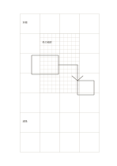

# 全体と細部の方眼

`grid-hierarchical` · `grid-dot` · `a5-draft`

[繁體中文](README.zh-TW.md) · [English](README.en.md) · [日本語](README.ja.md) · [一覧へ戻る](../../docs/ja/catalog.md)

大きなマスで全体を考え、中央の細かい格子で一部分を詳しく描きます。

## 向いている場面

- 部屋の区画を描いてから中央の作業机を詳しく見るとき。
- 展示板を配置してから重要な一区画を詰めるとき。

## 使い方

1. 外側の大きなマスで主要な区画を決めます。
2. 中央の細かい格子を拡大する部分に使い、二つの縮尺を混同しません。
3. 大きなマスと小さなマスがそれぞれ何を表すか記します。

## 記入後に見えること

方眼や点に沿って物、数、位置をそろえられます。

## 記入例

架空の読書コーナーを座席、棚、通路に分け、中央で机の配置を詳しく描く例です。

[SVG](examples/ja.svg)

## 向いていない場面

すべての場所に同じ細かさが必要なら局所的な細格子は偏ります。精密な図には寸法も必要です。

## ダウンロード

- [文字なしSVG](exports/a5-draft/blank.svg)
- [文字なしPDF](exports/a5-draft/blank.pdf)
- [左上に英語名があるPDF](exports/a5-draft/titled.pdf)
- [濃い線の文字なしPDF](exports/a5-contrast/blank.pdf)
- [濃い線のSVG](exports/a5-contrast/blank.svg)

英語名は表題付きPDFだけに印刷され、文字なし版は自由な記入に使えます。

用紙サイズ：A5（148 × 210 mm）。設定ファイル：`a5-draft`。

## 由来と状態

本プロジェクトの独自レイアウト · 詳しい由来の記録： [manifest.json](manifest.json)  
[MITライセンスの範囲](../../LICENSE-SCOPE.md)

[三言語の用語集](../../docs/ja/glossary.md)

## 変更と再生成

`profiles/a5-draft.json` または `src/noteformats/layouts/` の描画関数を変更し、プロジェクトのルートで実行します：

`python scripts/build.py --ids grid-hierarchical`
