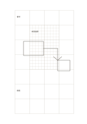

# 總覽與細節方格

`grid-hierarchical` · `grid-dot` · `a5-draft`

[繁體中文](README.zh-TW.md) · [English](README.en.md) · [日本語](README.ja.md) · [返回目錄](../../docs/zh-TW/catalog.md)

以大格規劃全局，再在中央細格區展開一個局部。

## 適合情境

- 先畫房間分區，再在中央細畫一處工作桌。
- 規劃展板配置後，細畫最重要的一塊。

## 使用步驟

1. 先用外圍大格配置主要區塊。
2. 選中央細格作為一個需要放大的局部，不把兩種比例混為一談。
3. 在旁邊記下大格與細格各代表的尺度。

## 整理後可得到

用格線或點位對齊物件、數量與相對位置。

## 實際填寫示例

示例把虛構閱讀角先分成座位、書架、通道，再在中央細格標出桌面配置。

[SVG](examples/zh-TW.svg)

## 不適合情境

若所有區域都需要同等細節，局部細格會造成偏重；精密製圖仍需明確尺寸。

## 下載

- [無字 SVG](exports/a5-draft/blank.svg)
- [無字 PDF](exports/a5-draft/blank.pdf)
- [左上角英文名稱 PDF](exports/a5-draft/titled.pdf)
- [深色墨線無字 PDF](exports/a5-contrast/blank.pdf)
- [深色墨線 SVG](exports/a5-contrast/blank.svg)

英文名稱只印在標題版 PDF；無字版仍適合自由列印與改作。

頁面尺寸：A5（148 × 210 mm）；設定檔：`a5-draft`。

## 來源與狀態

本專案原創版面 · 詳細來源紀錄見 [manifest.json](manifest.json)  
[MIT 授權範圍](../../LICENSE-SCOPE.md)

[三語術語表](../../docs/zh-TW/glossary.md)

## 修改與重新生成

修改 `profiles/a5-draft.json` 或 `src/noteformats/layouts/` 內對應的繪圖函式，再於專案根目錄執行：

`python scripts/build.py --ids grid-hierarchical`
