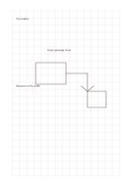

# Large square grid

`grid-large` · `grid-dot` · `a5-draft`

[繁體中文](README.zh-TW.md) · [English](README.en.md) · [日本語](README.ja.md) · [Back to catalog](../../docs/en/catalog.md)

Align short notes, simple drawings, and proportional drafts on equal squares. Geometry change: grid pitch: 8 mm.

## When to use it

**Geometry relationship:** `parameter` · [grid-standard](../grid-standard/README.en.md)

- Block out classroom zones on large squares, defining what spatial unit each cell represents.
- Give larger handwritten symbols one cell each when organizing a small classification or count.

## How to use it

1. Decide what one square represents on this page.
2. Place lines or short labels on the grid and leave adjacent cells for notes.
3. Check scale assumptions afterward and record real measurements separately.

## What the page helps you see

Aligned objects, counts, or spatial positions on the grid or dots.

## Worked example

A fictional reading corner uses cells for a table, chairs, and passage, with a width still to measure. The fictional entries indicate where short notes belong; they are neither measured data nor a complete research conclusion.

[SVG](examples/en.svg)

## When not to use it

The 8 mm cells accommodate larger symbols but give limited resolution for small component details; define the length or quantity represented by each square first.

## Downloads

- [Wordless SVG](exports/a5-draft/blank.svg)
- [Wordless PDF](exports/a5-draft/blank.pdf)
- [PDF with English name at top left](exports/a5-draft/titled.pdf)
- [Darker-ink wordless PDF](exports/a5-contrast/blank.pdf)
- [Darker-ink SVG](exports/a5-contrast/blank.svg)

The English name appears only on the titled PDF; the wordless version remains available for free writing.

Page size: A5 (148 × 210 mm); profile: `a5-draft`.

## Provenance and status

Adaptation of traditional writing paper · Detailed source record: [manifest.json](manifest.json)  
[MIT license scope](../../LICENSE-SCOPE.md)

[Trilingual glossary](../../docs/en/glossary.md)

## Modify and rebuild

Edit geometry in `src/noteformats/variants.py` or text in `src/noteformats/variant_content.py`, then run from the project root:

`python scripts/build.py --ids grid-large`
