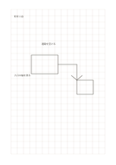

# 大きい方眼

`grid-large` · `grid-dot` · `a5-draft`

[繁體中文](README.zh-TW.md) · [English](README.en.md) · [日本語](README.ja.md) · [一覧へ戻る](../../docs/ja/catalog.md)

等間隔のマスで短い語句、簡単な図、比率の下描きをそろえます。 図形の変更： 方眼の間隔: 8 mm.

## 向いている場面

**図形の対応:** `parameter` · [grid-standard](../grid-standard/README.ja.md)

- 大きい方眼で教室の区画を描き、一マスの空間単位を自分で定めるとき。
- 少量の分類や数を、大きな記号で一マスずつ整理するとき。

## 使い方

1. このページで一マスが表す長さや項目を決めます。
2. 格子に沿って線や短い語を書き、隣のマスを注記用に残します。
3. あとで縮尺の仮定を確かめ、実測値は別に記します。

## 記入後に見えること

方眼や点に沿って物、数、位置をそろえられます。

## 記入例

架空の読書コーナーについて、机、椅子、通路をマスで表し、幅を後で測る例です。 架空の短い記入で各領域の使い方を示します。実測データや完全な調査結果ではありません。

[SVG](examples/ja.svg)

## 向いていない場面

8 mmの大きいマスには記号を大きく書けますが、小さな部品の細部を表すには粗くなります。一マスの長さや数量を先に決めます。

## ダウンロード

- [文字なしSVG](exports/a5-draft/blank.svg)
- [文字なしPDF](exports/a5-draft/blank.pdf)
- [左上に英語名があるPDF](exports/a5-draft/titled.pdf)
- [濃い線の文字なしPDF](exports/a5-contrast/blank.pdf)
- [濃い線のSVG](exports/a5-contrast/blank.svg)

英語名は表題付きPDFだけに印刷され、文字なし版は自由な記入に使えます。

用紙サイズ：A5（148 × 210 mm）。設定ファイル：`a5-draft`。

## 由来と状態

伝統的な練習紙の応用 · 詳しい由来の記録： [manifest.json](manifest.json)  
[MITライセンスの範囲](../../LICENSE-SCOPE.md)

[三言語の用語集](../../docs/ja/glossary.md)

## 変更と再生成

図形は `src/noteformats/variants.py`、文章は `src/noteformats/variant_content.py` を変更し、プロジェクトのルートで実行します：

`python scripts/build.py --ids grid-large`
