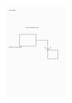

# Square grid

`grid-standard` · `grid-dot` · `a5-draft`

[繁體中文](README.zh-TW.md) · [English](README.en.md) · [日本語](README.ja.md) · [Back to catalog](../../docs/en/catalog.md)

Align short notes, simple drawings, and proportional drafts on equal squares.

## When to use it

- Sketch a simple seating or room layout.
- Line up a small set of values or symbols cell by cell.

## How to use it

1. Decide what one square represents on this page.
2. Place lines or short labels on the grid and leave adjacent cells for notes.
3. Check scale assumptions afterward and record real measurements separately.

## What the page helps you see

Aligned objects, counts, or spatial positions on the grid or dots.

## Worked example

A fictional reading corner uses cells for a table, chairs, and passage, with a width still to measure.

[SVG](examples/en.svg)

## When not to use it

Five-millimeter cells suit short marks rather than long handwriting. Without a stated unit, the sheet is not a precise engineering drawing.

## Downloads

- [Wordless SVG](exports/a5-draft/blank.svg)
- [Wordless PDF](exports/a5-draft/blank.pdf)
- [PDF with English name at top left](exports/a5-draft/titled.pdf)
- [Darker-ink wordless PDF](exports/a5-contrast/blank.pdf)
- [Darker-ink SVG](exports/a5-contrast/blank.svg)

The English name appears only on the titled PDF; the wordless version remains available for free writing.

Page size: A5 (148 × 210 mm); profile: `a5-draft`.

## Provenance and status

Adaptation of traditional writing paper · Detailed source record: [manifest.json](manifest.json)  
[MIT license scope](../../LICENSE-SCOPE.md)

[Trilingual glossary](../../docs/en/glossary.md)

## Modify and rebuild

Change `profiles/a5-draft.json` or the corresponding builder in `src/noteformats/layouts/`, then run from the project root:

`python scripts/build.py --ids grid-standard`
