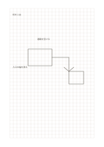

# 方眼ノート

`grid-standard` · `grid-dot` · `a5-draft`

[繁體中文](README.zh-TW.md) · [English](README.en.md) · [日本語](README.ja.md) · [一覧へ戻る](../../docs/ja/catalog.md)

等間隔のマスで短い語句、簡単な図、比率の下描きをそろえます。

## 向いている場面

- 座席や部屋の配置を簡単に描くとき。
- 少数の数値や記号をマスごとにそろえるとき。

## 使い方

1. このページで一マスが表す長さや項目を決めます。
2. 格子に沿って線や短い語を書き、隣のマスを注記用に残します。
3. あとで縮尺の仮定を確かめ、実測値は別に記します。

## 記入後に見えること

方眼や点に沿って物、数、位置をそろえられます。

## 記入例

架空の読書コーナーについて、机、椅子、通路をマスで表し、幅を後で測る例です。

[SVG](examples/ja.svg)

## 向いていない場面

5 mmのマスは短い記入向けで、長文には狭いものです。単位を決めないまま精密な製図には使えません。

## ダウンロード

- [文字なしSVG](exports/a5-draft/blank.svg)
- [文字なしPDF](exports/a5-draft/blank.pdf)
- [左上に英語名があるPDF](exports/a5-draft/titled.pdf)
- [濃い線の文字なしPDF](exports/a5-contrast/blank.pdf)
- [濃い線のSVG](exports/a5-contrast/blank.svg)

英語名は表題付きPDFだけに印刷され、文字なし版は自由な記入に使えます。

用紙サイズ：A5（148 × 210 mm）。設定ファイル：`a5-draft`。

## 由来と状態

伝統的な練習紙の応用 · 詳しい由来の記録： [manifest.json](manifest.json)  
[MITライセンスの範囲](../../LICENSE-SCOPE.md)

[三言語の用語集](../../docs/ja/glossary.md)

## 変更と再生成

`profiles/a5-draft.json` または `src/noteformats/layouts/` の描画関数を変更し、プロジェクトのルートで実行します：

`python scripts/build.py --ids grid-standard`
