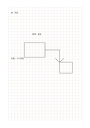

# 方格筆記

`grid-standard` · `grid-dot` · `a5-draft`

[繁體中文](README.zh-TW.md) · [English](README.en.md) · [日本語](README.ja.md) · [返回目錄](../../docs/zh-TW/catalog.md)

用等距方格對齊短語、簡圖與比例草稿。

## 適合情境

- 畫簡單的座位或空間配置草圖。
- 整理需要逐格對齊的少量數據。

## 使用步驟

1. 先決定一格在這頁代表的長度或一個項目。
2. 沿格線放置線條或短語，保留相鄰格作註解。
3. 最後檢查比例假設，必要時在紙外記下實際尺寸。

## 整理後可得到

用格線或點位對齊物件、數量與相對位置。

## 實際填寫示例

示例用幾格表示虛構閱讀角的桌、椅與通道，旁邊記下要量測的寬度。

[SVG](examples/zh-TW.svg)

## 不適合情境

5 mm 格適合短字或圖，不適合長篇手寫；未標定單位時也不能當精密工程圖。

## 下載

- [無字 SVG](exports/a5-draft/blank.svg)
- [無字 PDF](exports/a5-draft/blank.pdf)
- [左上角英文名稱 PDF](exports/a5-draft/titled.pdf)
- [深色墨線無字 PDF](exports/a5-contrast/blank.pdf)
- [深色墨線 SVG](exports/a5-contrast/blank.svg)

英文名稱只印在標題版 PDF；無字版仍適合自由列印與改作。

頁面尺寸：A5（148 × 210 mm）；設定檔：`a5-draft`。

## 來源與狀態

傳統書寫紙改編 · 詳細來源紀錄見 [manifest.json](manifest.json)  
[MIT 授權範圍](../../LICENSE-SCOPE.md)

[三語術語表](../../docs/zh-TW/glossary.md)

## 修改與重新生成

修改 `profiles/a5-draft.json` 或 `src/noteformats/layouts/` 內對應的繪圖函式，再於專案根目錄執行：

`python scripts/build.py --ids grid-standard`
