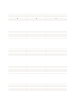

# Six-line guitar tablature

`guitar-tablature` · `special-paper` · `a5-draft`

[繁體中文](README.zh-TW.md) · [English](README.en.md) · [日本語](README.ja.md) · [Back to catalog](../../docs/en/catalog.md)

Use six string lines to jot fret positions and short playing patterns.

## When to use it

- Record finger positions for a melody you practice.
- Compare string choices during a rehearsal.

## How to use it

1. Identify and note the instrument's tuning instead of assuming standard tuning.
2. Write fret numbers on their string lines, reading left to right.
3. Add rhythm separately or check against audio; fret numbers alone do not fully encode duration.

## What the page helps you see

Notation, letterforms, or sketches aligned to the specialized guides.

## Worked example

The first system uses editable 0, 2, and 3 as an illustrative fret sequence; actual pitches depend on tuning.

[SVG](examples/en.svg)

## When not to use it

Tablature does not automatically carry full rhythm, tone, or fingering, and alternate tunings change pitches. Fine-line print is untested.

## Downloads

- [Wordless SVG](exports/a5-draft/blank.svg)
- [Wordless PDF](exports/a5-draft/blank.pdf)
- [PDF with English name at top left](exports/a5-draft/titled.pdf)
- [Darker-ink wordless PDF](exports/a5-contrast/blank.pdf)
- [Darker-ink SVG](exports/a5-contrast/blank.svg)

The English name appears only on the titled PDF; the wordless version remains available for free writing.

Page size: A5 (148 × 210 mm); profile: `a5-draft`.

## Provenance and status

Common geometry · Detailed source record: [manifest.json](manifest.json)  
[MIT license scope](../../LICENSE-SCOPE.md)

[Trilingual glossary](../../docs/en/glossary.md)

## Modify and rebuild

Change `profiles/a5-draft.json` or the corresponding builder in `src/noteformats/layouts/`, then run from the project root:

`python scripts/build.py --ids guitar-tablature`
