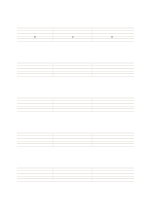

# 六線のギタータブ譜

`guitar-tablature` · `special-paper` · `a5-draft`

[繁體中文](README.zh-TW.md) · [English](README.en.md) · [日本語](README.ja.md) · [一覧へ戻る](../../docs/ja/catalog.md)

六本の弦の線にフレット位置と短い演奏案を書きます。

## 向いている場面

- 練習中の旋律の押さえる位置を残すとき。
- 合奏で弦の選び方を比べるとき。

## 使い方

1. 標準調弦と決めつけず、使う調弦を確認して控えます。
2. 対応する弦の線にフレット番号を書き、左から右へ読みます。
3. 番号だけでは音価が足りないため、リズムを別記するか音で照合します。

## 記入後に見えること

専用の罫線に沿った記譜、文字、下書きを確認できます。

## 記入例

最初の段の編集可能な 0、2、3 はフレット番号の置き方の例です。実際の音は調弦で確かめます。

[SVG](examples/ja.svg)

## 向いていない場面

タブ譜だけで完全なリズムや音色、運指は示せません。調弦が変われば音高も変わります。細線の印刷は未確認です。

## ダウンロード

- [文字なしSVG](exports/a5-draft/blank.svg)
- [文字なしPDF](exports/a5-draft/blank.pdf)
- [左上に英語名があるPDF](exports/a5-draft/titled.pdf)
- [濃い線の文字なしPDF](exports/a5-contrast/blank.pdf)
- [濃い線のSVG](exports/a5-contrast/blank.svg)

英語名は表題付きPDFだけに印刷され、文字なし版は自由な記入に使えます。

用紙サイズ：A5（148 × 210 mm）。設定ファイル：`a5-draft`。

## 由来と状態

一般的な幾何構造 · 詳しい由来の記録： [manifest.json](manifest.json)  
[MITライセンスの範囲](../../LICENSE-SCOPE.md)

[三言語の用語集](../../docs/ja/glossary.md)

## 変更と再生成

`profiles/a5-draft.json` または `src/noteformats/layouts/` の描画関数を変更し、プロジェクトのルートで実行します：

`python scripts/build.py --ids guitar-tablature`
