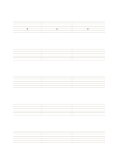

# 六線吉他指板譜

`guitar-tablature` · `special-paper` · `a5-draft`

[繁體中文](README.zh-TW.md) · [English](README.en.md) · [日本語](README.ja.md) · [返回目錄](../../docs/zh-TW/catalog.md)

用六條弦線記錄按弦位置與簡短樂句的把位草稿。

## 適合情境

- 記下自己練習的短旋律指法。
- 在練團時快速對照六條弦的按格位置。

## 使用步驟

1. 先確認自己使用的調弦，並在旁註明，不能假定標準調弦。
2. 在對應弦線寫琴格數，沿左到右讀。
3. 另外註記節奏或聽錄音核對，因格數本身不完整表示時值。

## 整理後可得到

依專用線格留下可檢查的記譜、練字或草圖。

## 實際填寫示例

示例第一段用 0、2、3 作虛構按格順序，僅示範數字放置，實際音高需依調弦核對。

[SVG](examples/zh-TW.svg)

## 不適合情境

指板譜不自動表達完整節奏、音色或指法；調弦不同會改變音高。

## 下載

- [無字 SVG](exports/a5-draft/blank.svg)
- [無字 PDF](exports/a5-draft/blank.pdf)
- [左上角英文名稱 PDF](exports/a5-draft/titled.pdf)
- [深色墨線無字 PDF](exports/a5-contrast/blank.pdf)
- [深色墨線 SVG](exports/a5-contrast/blank.svg)

英文名稱只印在標題版 PDF；無字版仍適合自由列印與改作。

頁面尺寸：A5（148 × 210 mm）；設定檔：`a5-draft`。

## 來源與狀態

通用幾何結構 · 詳細來源紀錄見 [manifest.json](manifest.json)  
[MIT 授權範圍](../../LICENSE-SCOPE.md)

[三語術語表](../../docs/zh-TW/glossary.md)

## 修改與重新生成

修改 `profiles/a5-draft.json` 或 `src/noteformats/layouts/` 內對應的繪圖函式，再於專案根目錄執行：

`python scripts/build.py --ids guitar-tablature`
