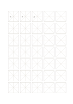

# Mi character practice grid

`hanzi-mi` · `special-paper` · `a5-draft`

[繁體中文](README.zh-TW.md) · [English](README.en.md) · [日本語](README.ja.md) · [Back to catalog](../../docs/en/catalog.md)

Use a center cross and diagonals to inspect slanted strokes and visual balance.

## When to use it

- Practice characters with left and right sweeping strokes.
- Compare white space in the four corners of repeated characters.

## How to use it

1. Find the center cross in the first square.
2. Use diagonals as visual references, not mandatory stroke tracks.
3. Repeat the character and compare its center and corner space.

## What the page helps you see

Notation, letterforms, or sketches aligned to the specialized guides.

## Worked example

The first three cells repeat editable 大 to compare how its left and right strokes spread.

[SVG](examples/en.svg)

## When not to use it

Diagonals are not fixed stroke angles; dense guides may distract some writers, who can choose the simpler Tian grid.

## Downloads

- [Wordless SVG](exports/a5-draft/blank.svg)
- [Wordless PDF](exports/a5-draft/blank.pdf)
- [PDF with English name at top left](exports/a5-draft/titled.pdf)
- [Darker-ink wordless PDF](exports/a5-contrast/blank.pdf)
- [Darker-ink SVG](exports/a5-contrast/blank.svg)

The English name appears only on the titled PDF; the wordless version remains available for free writing.

Page size: A5 (148 × 210 mm); profile: `a5-draft`.

## Provenance and status

Common geometry · Detailed source record: [manifest.json](manifest.json)  
[MIT license scope](../../LICENSE-SCOPE.md)

[Trilingual glossary](../../docs/en/glossary.md)

## Modify and rebuild

Change `profiles/a5-draft.json` or the corresponding builder in `src/noteformats/layouts/`, then run from the project root:

`python scripts/build.py --ids hanzi-mi`
