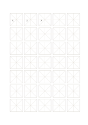

# 米字格練字紙

`hanzi-mi` · `special-paper` · `a5-draft`

[繁體中文](README.zh-TW.md) · [English](README.en.md) · [日本語](README.ja.md) · [返回目錄](../../docs/zh-TW/catalog.md)

用十字與對角線輔助觀察筆畫傾斜與字形重心。

## 適合情境

- 練習含撇捺的字，檢查斜向伸展。
- 比較同一字的四角留白是否均衡。

## 使用步驟

1. 先在首格找十字中心。
2. 參照斜線寫撇捺，避免把斜線當成必須貼齊的筆畫。
3. 在後續格重寫，檢查重心與四角空間。

## 整理後可得到

依專用線格留下可檢查的記譜、練字或草圖。

## 實際填寫示例

示例前三格寫『大』『大』『大』，觀察撇捺向兩側延伸時的平衡。

[SVG](examples/zh-TW.svg)

## 不適合情境

對角線不是每一筆的固定角度；密集輔助線可能干擾某些書寫者，必要時改用田字格。

## 下載

- [無字 SVG](exports/a5-draft/blank.svg)
- [無字 PDF](exports/a5-draft/blank.pdf)
- [左上角英文名稱 PDF](exports/a5-draft/titled.pdf)
- [深色墨線無字 PDF](exports/a5-contrast/blank.pdf)
- [深色墨線 SVG](exports/a5-contrast/blank.svg)

英文名稱只印在標題版 PDF；無字版仍適合自由列印與改作。

頁面尺寸：A5（148 × 210 mm）；設定檔：`a5-draft`。

## 來源與狀態

通用幾何結構 · 詳細來源紀錄見 [manifest.json](manifest.json)  
[MIT 授權範圍](../../LICENSE-SCOPE.md)

[三語術語表](../../docs/zh-TW/glossary.md)

## 修改與重新生成

修改 `profiles/a5-draft.json` 或 `src/noteformats/layouts/` 內對應的繪圖函式，再於專案根目錄執行：

`python scripts/build.py --ids hanzi-mi`
