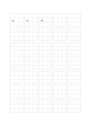

# Nine-section character grid

`hanzi-nine` · `special-paper` · `a5-draft`

[繁體中文](README.zh-TW.md) · [English](README.en.md) · [日本語](README.ja.md) · [Back to catalog](../../docs/en/catalog.md)

Divide each character square into nine guide regions to inspect component placement.

## When to use it

- Study upper, middle, and lower parts of a complex character.
- Practice keeping the same character balanced across attempts.

## How to use it

1. Treat the nine sections as position references for major components.
2. Write one character per large cell and adjust spacing over later cells.
3. Judge the whole shape rather than forcing every stroke into one mini-cell.

## What the page helps you see

Notation, letterforms, or sketches aligned to the specialized guides.

## Worked example

The first three large cells repeat editable 語 to compare left and right components; the nine subcells are guides only.

[SVG](examples/en.svg)

## When not to use it

Each interior section is about 7 mm and is not a separate writing cell. Fine-line print clarity remains untested.

## Downloads

- [Wordless SVG](exports/a5-draft/blank.svg)
- [Wordless PDF](exports/a5-draft/blank.pdf)
- [PDF with English name at top left](exports/a5-draft/titled.pdf)
- [Darker-ink wordless PDF](exports/a5-contrast/blank.pdf)
- [Darker-ink SVG](exports/a5-contrast/blank.svg)

The English name appears only on the titled PDF; the wordless version remains available for free writing.

Page size: A5 (148 × 210 mm); profile: `a5-draft`.

## Provenance and status

Common geometry · Detailed source record: [manifest.json](manifest.json)  
[MIT license scope](../../LICENSE-SCOPE.md)

[Trilingual glossary](../../docs/en/glossary.md)

## Modify and rebuild

Change `profiles/a5-draft.json` or the corresponding builder in `src/noteformats/layouts/`, then run from the project root:

`python scripts/build.py --ids hanzi-nine`
