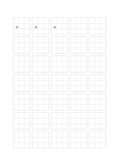

# 九分割の漢字練習紙

`hanzi-nine` · `special-paper` · `a5-draft`

[繁體中文](README.zh-TW.md) · [English](README.en.md) · [日本語](README.ja.md) · [一覧へ戻る](../../docs/ja/catalog.md)

一字の枠を九つの目安に分け、部品の位置と比率を見ます。

## 向いている場面

- 複雑な字の上中下の部品を分析するとき。
- 同じ字の重心を繰り返し確かめるとき。

## 使い方

1. 九分割を主要な部品の位置の目安として見ます。
2. 大きな枠に一字を書き、次の枠で間隔を調整します。
3. 各画を小枠に押し込まず、字全体の形を見直します。

## 記入後に見えること

専用の罫線に沿った記譜、文字、下書きを確認できます。

## 記入例

最初の大枠三つに編集可能な『語』を繰り返し、左右の部品の位置を比べます。

[SVG](examples/ja.svg)

## 向いていない場面

内部の一区画は約7 mmで、一字を書く枠ではありません。細線の印刷品質は未確認です。

## ダウンロード

- [文字なしSVG](exports/a5-draft/blank.svg)
- [文字なしPDF](exports/a5-draft/blank.pdf)
- [左上に英語名があるPDF](exports/a5-draft/titled.pdf)
- [濃い線の文字なしPDF](exports/a5-contrast/blank.pdf)
- [濃い線のSVG](exports/a5-contrast/blank.svg)

英語名は表題付きPDFだけに印刷され、文字なし版は自由な記入に使えます。

用紙サイズ：A5（148 × 210 mm）。設定ファイル：`a5-draft`。

## 由来と状態

一般的な幾何構造 · 詳しい由来の記録： [manifest.json](manifest.json)  
[MITライセンスの範囲](../../LICENSE-SCOPE.md)

[三言語の用語集](../../docs/ja/glossary.md)

## 変更と再生成

`profiles/a5-draft.json` または `src/noteformats/layouts/` の描画関数を変更し、プロジェクトのルートで実行します：

`python scripts/build.py --ids hanzi-nine`
