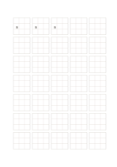

# 九分格練字紙

`hanzi-nine` · `special-paper` · `a5-draft`

[繁體中文](README.zh-TW.md) · [English](README.en.md) · [日本語](README.ja.md) · [返回目錄](../../docs/zh-TW/catalog.md)

把單字空間分成九區，觀察部件位置與字形比例。

## 適合情境

- 分析複雜字的上中下部件。
- 練習讓同一字在方格內保持穩定重心。

## 使用步驟

1. 把九格當定位參照，先看字的主要部件落在哪些區。
2. 在第一格寫字，後續格逐次調整部件距離。
3. 從整體看重心，不要讓每個筆畫都僵硬地塞進小格。

## 整理後可得到

依專用線格留下可檢查的記譜、練字或草圖。

## 實際填寫示例

示例首三個大格重複『語』，觀察言字旁與右側部件的位置；不是把九個小格各填一字。

[SVG](examples/zh-TW.svg)

## 不適合情境

內部小格約 7 mm，只是參照，不能每格寫一個字；未試印時細線清晰度未知。

## 下載

- [無字 SVG](exports/a5-draft/blank.svg)
- [無字 PDF](exports/a5-draft/blank.pdf)
- [左上角英文名稱 PDF](exports/a5-draft/titled.pdf)
- [深色墨線無字 PDF](exports/a5-contrast/blank.pdf)
- [深色墨線 SVG](exports/a5-contrast/blank.svg)

英文名稱只印在標題版 PDF；無字版仍適合自由列印與改作。

頁面尺寸：A5（148 × 210 mm）；設定檔：`a5-draft`。

## 來源與狀態

通用幾何結構 · 詳細來源紀錄見 [manifest.json](manifest.json)  
[MIT 授權範圍](../../LICENSE-SCOPE.md)

[三語術語表](../../docs/zh-TW/glossary.md)

## 修改與重新生成

修改 `profiles/a5-draft.json` 或 `src/noteformats/layouts/` 內對應的繪圖函式，再於專案根目錄執行：

`python scripts/build.py --ids hanzi-nine`
