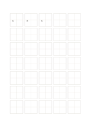

# Tian character practice grid

`hanzi-tian` · `special-paper` · `a5-draft`

[繁體中文](README.zh-TW.md) · [English](README.en.md) · [日本語](README.ja.md) · [Back to catalog](../../docs/en/catalog.md)

Use a vertical and horizontal center guide to inspect balance within one character square.

## When to use it

- Practice the center and component placement of a Chinese character.
- Compare spatial balance across repeated attempts.

## How to use it

1. Choose one character and locate its visual center in the first cell.
2. Use the cross to compare left, right, upper, and lower parts as you repeat it.
3. Review white space and stroke position, choosing one proportion to improve.

## What the page helps you see

Notation, letterforms, or sketches aligned to the specialized guides.

## Worked example

The first three cells show the editable character 永 repeated for balance comparison; the other cells stay blank.

[SVG](examples/en.svg)

## When not to use it

The cross is a spatial guide, not a typeface standard or stroke-order lesson. Each A5 cell is about 21 mm and is not for long prose.

## Downloads

- [Wordless SVG](exports/a5-draft/blank.svg)
- [Wordless PDF](exports/a5-draft/blank.pdf)
- [PDF with English name at top left](exports/a5-draft/titled.pdf)
- [Darker-ink wordless PDF](exports/a5-contrast/blank.pdf)
- [Darker-ink SVG](exports/a5-contrast/blank.svg)

The English name appears only on the titled PDF; the wordless version remains available for free writing.

Page size: A5 (148 × 210 mm); profile: `a5-draft`.

## Provenance and status

Common geometry · Detailed source record: [manifest.json](manifest.json)  
[MIT license scope](../../LICENSE-SCOPE.md)

[Trilingual glossary](../../docs/en/glossary.md)

## Modify and rebuild

Change `profiles/a5-draft.json` or the corresponding builder in `src/noteformats/layouts/`, then run from the project root:

`python scripts/build.py --ids hanzi-tian`
