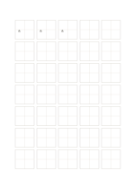

# 田字格練字紙

`hanzi-tian` · `special-paper` · `a5-draft`

[繁體中文](README.zh-TW.md) · [English](README.en.md) · [日本語](README.ja.md) · [返回目錄](../../docs/zh-TW/catalog.md)

用十字中心線協助觀察單字的左右與上下比例。

## 適合情境

- 練習單個漢字的重心與部件位置。
- 比較同一字不同寫法的空間分配。

## 使用步驟

1. 先選一個字，在首格觀察重心。
2. 沿中心線分辨左右、上下部件，再寫入其他格。
3. 回看每格的留白與筆畫位置，找出一項要改進的比例。

## 整理後可得到

依專用線格留下可檢查的記譜、練字或草圖。

## 實際填寫示例

示例前三格依次寫『永』『永』『永』，用來觀察同一字的中心位置；其餘格保持空白。

[SVG](examples/zh-TW.svg)

## 不適合情境

中心線只輔助結構，不是字體標準或筆順教學。A5 的單格約 21 mm，長篇書寫不適合。

## 下載

- [無字 SVG](exports/a5-draft/blank.svg)
- [無字 PDF](exports/a5-draft/blank.pdf)
- [左上角英文名稱 PDF](exports/a5-draft/titled.pdf)
- [深色墨線無字 PDF](exports/a5-contrast/blank.pdf)
- [深色墨線 SVG](exports/a5-contrast/blank.svg)

英文名稱只印在標題版 PDF；無字版仍適合自由列印與改作。

頁面尺寸：A5（148 × 210 mm）；設定檔：`a5-draft`。

## 來源與狀態

通用幾何結構 · 詳細來源紀錄見 [manifest.json](manifest.json)  
[MIT 授權範圍](../../LICENSE-SCOPE.md)

[三語術語表](../../docs/zh-TW/glossary.md)

## 修改與重新生成

修改 `profiles/a5-draft.json` 或 `src/noteformats/layouts/` 內對應的繪圖函式，再於專案根目錄執行：

`python scripts/build.py --ids hanzi-tian`
