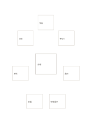

# 中心案と七つの変化

`hero-idea-seven-variations` · `ideation` · `a5-draft`

[繁體中文](README.zh-TW.md) · [English](README.en.md) · [日本語](README.ja.md) · [一覧へ戻る](../../docs/ja/catalog.md)

中心に主案を置き、周囲の七枚で変化案を試します。 図形の変更： 中心の外側カード数: 7.

## 向いている場面

**図形の対応:** `parameter` · [center-eight-boxes](../center-eight-boxes/README.ja.md)

- 中心にポスターの基本案を描き、外側の七枚で一つずつ配置を変えてみるとき。
- 一つのサービス案を核に、素材・手順・やり取りの七つの変化を探るとき。

## 使い方

1. 中心に基本案、外側の各カードに一つの変更案を置きます。
2. 記入例を参考に、領域の順で記します：1「会場」；2「作品」；3「手伝い」；4「案内」；5「地域展示」；6「交通」；7「材料」；8「日程」
3. 各領域を読み返し、未確認の点と次の行動を記します。

## 記入後に見えること

複数の案と、次に選ぶための基準が残ります。

## 記入例

図の記入位置の順に示します。番号一つが一つの記入例です：

1. 会場
2. 作品
3. 手伝い
4. 案内
5. 地域展示
6. 交通
7. 材料
8. 日程

[SVG](examples/ja.svg)

## 向いていない場面

枠に順序はありません。位置だけで依存関係を推測しないでください。 小さなマスは短い語句向けで、長い文章には向きません。

## ダウンロード

- [文字なしSVG](exports/a5-draft/blank.svg)
- [文字なしPDF](exports/a5-draft/blank.pdf)
- [左上に英語名があるPDF](exports/a5-draft/titled.pdf)
- [濃い線の文字なしPDF](exports/a5-contrast/blank.pdf)
- [濃い線のSVG](exports/a5-contrast/blank.svg)

英語名は表題付きPDFだけに印刷され、文字なし版は自由な記入に使えます。

用紙サイズ：A5（148 × 210 mm）。設定ファイル：`a5-draft`。

## 由来と状態

本プロジェクトの独自レイアウト · 詳しい由来の記録： [manifest.json](manifest.json)  
[MITライセンスの範囲](../../LICENSE-SCOPE.md)

[三言語の用語集](../../docs/ja/glossary.md)

## 変更と再生成

図形は `src/noteformats/variants.py`、文章は `src/noteformats/variant_content.py` を変更し、プロジェクトのルートで実行します：

`python scripts/build.py --ids hero-idea-seven-variations`
