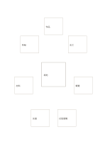

# 主構想與七變化

`hero-idea-seven-variations` · `ideation` · `a5-draft`

[繁體中文](README.zh-TW.md) · [English](README.en.md) · [日本語](README.ja.md) · [返回目錄](../../docs/zh-TW/catalog.md)

先畫中心主構想，再將七種變化分放周圍卡片。 本款的幾何變化： 中心外側變化數: 7.

## 適合情境

**幾何對照:** `parameter` · [center-eight-boxes](../center-eight-boxes/README.zh-TW.md)

- 中央畫一個海報主構想，外側七卡各試一種版面改動。
- 以一個服務方案為核心，探索七個不同的材料、流程或互動變化。

## 使用步驟

1. 中央放核心方案，外側各卡放一個改動方向，再比較取捨。
2. 參考本頁示例，各區依序記錄：1「場地」；2「作品」；3「志工」；4「導覽」；5「社區展覽」；6「交通」；7「材料」；8「時程」
3. 回看各區，標記仍待查證的內容，再決定下一步。

## 整理後可得到

保留多種方案並說明下一輪篩選依據。

## 實際填寫示例

依圖中填寫位置順序列出，每個編號是一筆示例條目：

1. 場地
2. 作品
3. 志工
4. 導覽
5. 社區展覽
6. 交通
7. 材料
8. 時程

[SVG](examples/zh-TW.svg)

## 不適合情境

卡片之間沒有預設流程；需要順序或依賴關係時不應只靠位置推斷。 細小格子只宜短語，不適合長篇段落。

## 下載

- [無字 SVG](exports/a5-draft/blank.svg)
- [無字 PDF](exports/a5-draft/blank.pdf)
- [左上角英文名稱 PDF](exports/a5-draft/titled.pdf)
- [深色墨線無字 PDF](exports/a5-contrast/blank.pdf)
- [深色墨線 SVG](exports/a5-contrast/blank.svg)

英文名稱只印在標題版 PDF；無字版仍適合自由列印與改作。

頁面尺寸：A5（148 × 210 mm）；設定檔：`a5-draft`。

## 來源與狀態

本專案原創版面 · 詳細來源紀錄見 [manifest.json](manifest.json)  
[MIT 授權範圍](../../LICENSE-SCOPE.md)

[三語術語表](../../docs/zh-TW/glossary.md)

## 修改與重新生成

調整 `src/noteformats/variants.py` 的幾何或 `src/noteformats/variant_content.py` 的文字，再於專案根目錄執行：

`python scripts/build.py --ids hero-idea-seven-variations`
