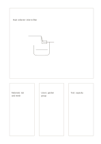

# Hero card with three supports

`hero-three-cards` · `cards` · `a5-draft`

[繁體中文](README.zh-TW.md) · [English](README.en.md) · [日本語](README.ja.md) · [Back to catalog](../../docs/en/catalog.md)

Give one main idea a large area and reserve three smaller supporting areas below.

## When to use it

- Sketch a main visual, then note materials, audience, and risks.
- State a research question and list three evidence leads.

## How to use it

1. Put the main idea or question in the large upper card.
2. Use the three lower cards for support conditions or counterexamples.
3. Check that each lower card really relates to the main one and remove irrelevant entries.

## What the page helps you see

Separate units that can be reordered, compared, or selected.

## Worked example

A fictional rainwater collector occupies the large card; materials, users, and a risk to test sit below.

[SVG](examples/en.svg)

## When not to use it

When all four topics matter equally, the oversized card creates a misleading priority.

## Downloads

- [Wordless SVG](exports/a5-draft/blank.svg)
- [Wordless PDF](exports/a5-draft/blank.pdf)
- [PDF with English name at top left](exports/a5-draft/titled.pdf)
- [Darker-ink wordless PDF](exports/a5-contrast/blank.pdf)
- [Darker-ink SVG](exports/a5-contrast/blank.svg)

The English name appears only on the titled PDF; the wordless version remains available for free writing.

Page size: A5 (148 × 210 mm); profile: `a5-draft`.

## Provenance and status

Original layout · Detailed source record: [manifest.json](manifest.json)  
[MIT license scope](../../LICENSE-SCOPE.md)

[Trilingual glossary](../../docs/en/glossary.md)

## Modify and rebuild

Change `profiles/a5-draft.json` or the corresponding builder in `src/noteformats/layouts/`, then run from the project root:

`python scripts/build.py --ids hero-three-cards`
