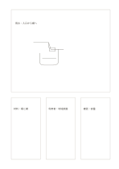

# 主カードと三つの補助カード

`hero-three-cards` · `cards` · `a5-draft`

[繁體中文](README.zh-TW.md) · [English](README.en.md) · [日本語](README.ja.md) · [一覧へ戻る](../../docs/ja/catalog.md)

主な考えに広い枠を与え、下に三つの支える観点を置きます。

## 向いている場面

- 主な図を描いたあと材料、対象者、リスクを並べるとき。
- 研究の問いを書き、三つの根拠の手がかりを探すとき。

## 使い方

1. 大きい上の枠に主な考えや問いを置きます。
2. 下の三枠に支える条件や反例を一つずつ書きます。
3. 各枠が主題と本当に関係するか見直し、無関係なら外します。

## 記入後に見えること

項目を分けて、並べ替えや比較、選択ができます。

## 記入例

架空の雨水収集器を大きな枠に置き、下に材料、利用者、試すべきリスクを書いています。

[SVG](examples/ja.svg)

## 向いていない場面

四つの話題が同じ重みなら大きな枠が誤った優先順位を作ります。

## ダウンロード

- [文字なしSVG](exports/a5-draft/blank.svg)
- [文字なしPDF](exports/a5-draft/blank.pdf)
- [左上に英語名があるPDF](exports/a5-draft/titled.pdf)
- [濃い線の文字なしPDF](exports/a5-contrast/blank.pdf)
- [濃い線のSVG](exports/a5-contrast/blank.svg)

英語名は表題付きPDFだけに印刷され、文字なし版は自由な記入に使えます。

用紙サイズ：A5（148 × 210 mm）。設定ファイル：`a5-draft`。

## 由来と状態

本プロジェクトの独自レイアウト · 詳しい由来の記録： [manifest.json](manifest.json)  
[MITライセンスの範囲](../../LICENSE-SCOPE.md)

[三言語の用語集](../../docs/ja/glossary.md)

## 変更と再生成

`profiles/a5-draft.json` または `src/noteformats/layouts/` の描画関数を変更し、プロジェクトのルートで実行します：

`python scripts/build.py --ids hero-three-cards`
