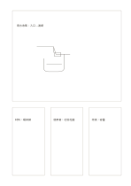

# 主卡加三輔卡

`hero-three-cards` · `cards` · `a5-draft`

[繁體中文](README.zh-TW.md) · [English](README.en.md) · [日本語](README.ja.md) · [返回目錄](../../docs/zh-TW/catalog.md)

上方給主要構想較大空間，下方保留三個支持面向。

## 適合情境

- 畫主視覺草圖後列材料、受眾與風險。
- 描述一個研究問題後分列三項證據線索。

## 使用步驟

1. 先把主要構想或問題放入大卡。
2. 在下方三卡各寫一個支援條件或反例。
3. 回看三卡是否真正支持主卡，刪去無關項目。

## 整理後可得到

把可移動的事項分開，方便排序、比較或選擇。

## 實際填寫示例

示例的大卡是虛構雨水收集器，下方分記材料、使用者與待測風險。

[SVG](examples/zh-TW.svg)

## 不適合情境

四個主題同等重要時，大卡會造成不合理的視覺優先順序。

## 下載

- [無字 SVG](exports/a5-draft/blank.svg)
- [無字 PDF](exports/a5-draft/blank.pdf)
- [左上角英文名稱 PDF](exports/a5-draft/titled.pdf)
- [深色墨線無字 PDF](exports/a5-contrast/blank.pdf)
- [深色墨線 SVG](exports/a5-contrast/blank.svg)

英文名稱只印在標題版 PDF；無字版仍適合自由列印與改作。

頁面尺寸：A5（148 × 210 mm）；設定檔：`a5-draft`。

## 來源與狀態

本專案原創版面 · 詳細來源紀錄見 [manifest.json](manifest.json)  
[MIT 授權範圍](../../LICENSE-SCOPE.md)

[三語術語表](../../docs/zh-TW/glossary.md)

## 修改與重新生成

修改 `profiles/a5-draft.json` 或 `src/noteformats/layouts/` 內對應的繪圖函式，再於專案根目錄執行：

`python scripts/build.py --ids hero-three-cards`
