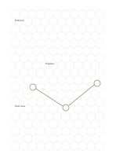

# Hexagonal grid

`hex-grid` · `geometry` · `a5-draft`

[繁體中文](README.zh-TW.md) · [English](README.en.md) · [日本語](README.ja.md) · [Back to catalog](../../docs/en/catalog.md)

Use neighboring hexagonal cells to show adjacency, clusters, and routes.

## When to use it

- Compare which exhibition booths touch one another.
- Draft regions and movement for a tabletop game.

## How to use it

1. Decide what each hexagon represents: a place, object, or state.
2. Put related items in neighboring cells and mark movement across shared edges.
3. Check for exceptions that need an explanation outside the cells.

## What the page helps you see

A draft of direction, proportion, or placement, with measurements still to check.

## Worked example

A fictional exhibition puts an entrance, displays, and rest area in adjacent cells, then sketches a visitor route.

[SVG](examples/en.svg)

## When not to use it

Hexagons do not support long rows of prose or exact rectangular measurement; cell size is provisional.

## Downloads

- [Wordless SVG](exports/a5-draft/blank.svg)
- [Wordless PDF](exports/a5-draft/blank.pdf)
- [PDF with English name at top left](exports/a5-draft/titled.pdf)
- [Darker-ink wordless PDF](exports/a5-contrast/blank.pdf)
- [Darker-ink SVG](exports/a5-contrast/blank.svg)

The English name appears only on the titled PDF; the wordless version remains available for free writing.

Page size: A5 (148 × 210 mm); profile: `a5-draft`.

## Provenance and status

Adaptation of traditional writing paper · Detailed source record: [manifest.json](manifest.json)  
[MIT license scope](../../LICENSE-SCOPE.md)

[Trilingual glossary](../../docs/en/glossary.md)

## Modify and rebuild

Change `profiles/a5-draft.json` or the corresponding builder in `src/noteformats/layouts/`, then run from the project root:

`python scripts/build.py --ids hex-grid`
