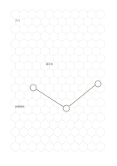

# 六角形の格子

`hex-grid` · `geometry` · `a5-draft`

[繁體中文](README.zh-TW.md) · [English](README.en.md) · [日本語](README.ja.md) · [一覧へ戻る](../../docs/ja/catalog.md)

隣り合う六角形で接続、まとまり、通る道を表します。

## 向いている場面

- 展示ブース同士の隣接を比べるとき。
- 卓上ゲームの領域と移動を下描きするとき。

## 使い方

1. 一つの六角形が場所、物、状態のどれを表すか決めます。
2. 関連する項目を隣のマスに置き、共有する辺を通る関係を示します。
3. マスをまたぐ例外があれば別に説明を加えます。

## 記入後に見えること

向き、比率、配置と、追加で測る箇所が見えます。

## 記入例

架空の展示会で入口、展示台、休憩場所を隣接したマスに置き、見学経路を描く例です。

[SVG](examples/ja.svg)

## 向いていない場面

長文を行ごとに書く用途や正確な長方形の測定には向きません。マスの大きさは暫定です。

## ダウンロード

- [文字なしSVG](exports/a5-draft/blank.svg)
- [文字なしPDF](exports/a5-draft/blank.pdf)
- [左上に英語名があるPDF](exports/a5-draft/titled.pdf)
- [濃い線の文字なしPDF](exports/a5-contrast/blank.pdf)
- [濃い線のSVG](exports/a5-contrast/blank.svg)

英語名は表題付きPDFだけに印刷され、文字なし版は自由な記入に使えます。

用紙サイズ：A5（148 × 210 mm）。設定ファイル：`a5-draft`。

## 由来と状態

伝統的な練習紙の応用 · 詳しい由来の記録： [manifest.json](manifest.json)  
[MITライセンスの範囲](../../LICENSE-SCOPE.md)

[三言語の用語集](../../docs/ja/glossary.md)

## 変更と再生成

`profiles/a5-draft.json` または `src/noteformats/layouts/` の描画関数を変更し、プロジェクトのルートで実行します：

`python scripts/build.py --ids hex-grid`
