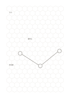

# 六角蜂巢格

`hex-grid` · `geometry` · `a5-draft`

[繁體中文](README.zh-TW.md) · [English](README.en.md) · [日本語](README.ja.md) · [返回目錄](../../docs/zh-TW/catalog.md)

用相鄰六角格描述鄰接、群聚與路徑。

## 適合情境

- 比較哪些展位彼此相鄰。
- 草擬桌面遊戲的區域與移動路徑。

## 使用步驟

1. 先決定每個六角格代表一個地點、物件或狀態。
2. 在相鄰格中放入相關項目，沿共同邊標記可通行關係。
3. 最後檢查是否有必須跨格說明的例外。

## 整理後可得到

看出方向、比例或空間配置中需要再測量之處。

## 實際填寫示例

示例把虛構展區的入口、展示台與休息處放入相鄰蜂巢格，再描出一條參觀路徑。

[SVG](examples/zh-TW.svg)

## 不適合情境

六角格不適合逐列長文或精確矩形測量；格距仍是暫定值。

## 下載

- [無字 SVG](exports/a5-draft/blank.svg)
- [無字 PDF](exports/a5-draft/blank.pdf)
- [左上角英文名稱 PDF](exports/a5-draft/titled.pdf)
- [深色墨線無字 PDF](exports/a5-contrast/blank.pdf)
- [深色墨線 SVG](exports/a5-contrast/blank.svg)

英文名稱只印在標題版 PDF；無字版仍適合自由列印與改作。

頁面尺寸：A5（148 × 210 mm）；設定檔：`a5-draft`。

## 來源與狀態

傳統書寫紙改編 · 詳細來源紀錄見 [manifest.json](manifest.json)  
[MIT 授權範圍](../../LICENSE-SCOPE.md)

[三語術語表](../../docs/zh-TW/glossary.md)

## 修改與重新生成

修改 `profiles/a5-draft.json` 或 `src/noteformats/layouts/` 內對應的繪圖函式，再於專案根目錄執行：

`python scripts/build.py --ids hex-grid`
