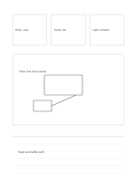

# Three cards, main sketch, conclusion

`hybrid-multi-zone` · `hybrid` · `a5-draft`

[繁體中文](README.zh-TW.md) · [English](README.en.md) · [日本語](README.ja.md) · [Back to catalog](../../docs/en/catalog.md)

List three conditions, draw one overall idea, and state a conclusion supported by the sketch.

## When to use it

- List needs, sketch a small exhibition, and record a decision.
- Compare three interview clues before sketching a service path.

## How to use it

1. Put one distinct condition or clue in each upper card.
2. Sketch an idea in the large middle area that addresses all three.
3. Write the current choice, reason, and missing check on the lower lines.

## What the page helps you see

A drawing, short notes, and a conclusion kept separate but connected.

## Worked example

A fictional exhibit lists entry, seating, and light, sketches tables, then proposes keeping the entrance open while checking light on site.

[SVG](examples/en.svg)

## When not to use it

A sketch is not a validated solution, and a few bottom lines cannot hold a full research record.

## Downloads

- [Wordless SVG](exports/a5-draft/blank.svg)
- [Wordless PDF](exports/a5-draft/blank.pdf)
- [PDF with English name at top left](exports/a5-draft/titled.pdf)
- [Darker-ink wordless PDF](exports/a5-contrast/blank.pdf)
- [Darker-ink SVG](exports/a5-contrast/blank.svg)

The English name appears only on the titled PDF; the wordless version remains available for free writing.

Page size: A5 (148 × 210 mm); profile: `a5-draft`.

## Provenance and status

Original layout · Detailed source record: [manifest.json](manifest.json)  
[MIT license scope](../../LICENSE-SCOPE.md)

[Trilingual glossary](../../docs/en/glossary.md)

## Modify and rebuild

Change `profiles/a5-draft.json` or the corresponding builder in `src/noteformats/layouts/`, then run from the project root:

`python scripts/build.py --ids hybrid-multi-zone`
