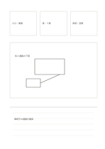

# 三カード・主図・結論

`hybrid-multi-zone` · `hybrid` · `a5-draft`

[繁體中文](README.zh-TW.md) · [English](README.en.md) · [日本語](README.ja.md) · [一覧へ戻る](../../docs/ja/catalog.md)

三つの条件を挙げ、全体図を描き、そこから得た結論を書きます。

## 向いている場面

- 小さな展示の条件、配置、決定を一枚にまとめるとき。
- 三つの聞き取りの手掛かりからサービスの流れを描くとき。

## 使い方

1. 上の三カードに異なる条件や手掛かりを書きます。
2. 中央の大枠に三条件へ応える草図を描きます。
3. 下に現在の選択、理由、未確認事項を書きます。

## 記入後に見えること

図、短い記録、結論を分けながら関係づけられます。

## 記入例

架空の展示で入口、座席、照明を挙げ、机の配置を描き、入口を空ける案と照明の現地確認を書きます。

[SVG](examples/ja.svg)

## 向いていない場面

草図は検証済みの解決策ではありません。下の数行で研究の全記録もできません。

## ダウンロード

- [文字なしSVG](exports/a5-draft/blank.svg)
- [文字なしPDF](exports/a5-draft/blank.pdf)
- [左上に英語名があるPDF](exports/a5-draft/titled.pdf)
- [濃い線の文字なしPDF](exports/a5-contrast/blank.pdf)
- [濃い線のSVG](exports/a5-contrast/blank.svg)

英語名は表題付きPDFだけに印刷され、文字なし版は自由な記入に使えます。

用紙サイズ：A5（148 × 210 mm）。設定ファイル：`a5-draft`。

## 由来と状態

本プロジェクトの独自レイアウト · 詳しい由来の記録： [manifest.json](manifest.json)  
[MITライセンスの範囲](../../LICENSE-SCOPE.md)

[三言語の用語集](../../docs/ja/glossary.md)

## 変更と再生成

`profiles/a5-draft.json` または `src/noteformats/layouts/` の描画関数を変更し、プロジェクトのルートで実行します：

`python scripts/build.py --ids hybrid-multi-zone`
