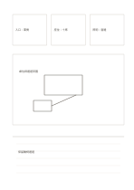

# 三卡、主圖與結論

`hybrid-multi-zone` · `hybrid` · `a5-draft`

[繁體中文](README.zh-TW.md) · [English](README.en.md) · [日本語](README.ja.md) · [返回目錄](../../docs/zh-TW/catalog.md)

先列三個條件，中間畫整體草圖，底部寫出由圖得出的結論。

## 適合情境

- 設計小型展場時列需求、畫配置、記決定。
- 比較三個訪談線索後畫可能的服務路徑。

## 使用步驟

1. 上方三卡各寫一項不同條件或線索。
2. 中間大框畫能同時回應三卡的草圖。
3. 底部寫目前的選擇、理由與仍待核對的部分。

## 整理後可得到

把圖、短記與結論放在各自區域，再檢查關係。

## 實際填寫示例

虛構展場的三卡記入口、座位、照明；中間畫桌位，底部寫『入口先保持開闊，照明需現場查』。

[SVG](examples/zh-TW.svg)

## 不適合情境

草圖不等於已驗證方案；底部幾行不足以記錄完整研究資料。

## 下載

- [無字 SVG](exports/a5-draft/blank.svg)
- [無字 PDF](exports/a5-draft/blank.pdf)
- [左上角英文名稱 PDF](exports/a5-draft/titled.pdf)
- [深色墨線無字 PDF](exports/a5-contrast/blank.pdf)
- [深色墨線 SVG](exports/a5-contrast/blank.svg)

英文名稱只印在標題版 PDF；無字版仍適合自由列印與改作。

頁面尺寸：A5（148 × 210 mm）；設定檔：`a5-draft`。

## 來源與狀態

本專案原創版面 · 詳細來源紀錄見 [manifest.json](manifest.json)  
[MIT 授權範圍](../../LICENSE-SCOPE.md)

[三語術語表](../../docs/zh-TW/glossary.md)

## 修改與重新生成

修改 `profiles/a5-draft.json` 或 `src/noteformats/layouts/` 內對應的繪圖函式，再於專案根目錄執行：

`python scripts/build.py --ids hybrid-multi-zone`
