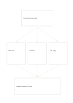

# Hypothesis and three evidence cards

`hypothesis-evidence` · `causal` · `a5-draft`

[繁體中文](README.zh-TW.md) · [English](README.en.md) · [日本語](README.ja.md) · [Back to catalog](../../docs/en/catalog.md)

State a testable hypothesis, examine three observations or counterexamples, and update the assessment.

## When to use it

- Check whether an event design really changes participation.
- Separate a research summary's claim from observable data.

## How to use it

1. Write a specific hypothesis that evidence could disconfirm.
2. Put one source, observation, or counterexample in each middle card and mark its direction.
3. Use the bottom only for the assessment currently supported and the next check.

## What the page helps you see

Observed outcomes separated from causal hypotheses and unsupported links.

## Worked example

A fictional reading group asks whether short reminders increase attendance, considering sign-ups, arrivals, and nonresponses before noting a missing baseline.

[SVG](examples/en.svg)

## When not to use it

Three cards cannot assess a complex study, and illustrative data are not experimental results.

## Downloads

- [Wordless SVG](exports/a5-draft/blank.svg)
- [Wordless PDF](exports/a5-draft/blank.pdf)
- [PDF with English name at top left](exports/a5-draft/titled.pdf)
- [Darker-ink wordless PDF](exports/a5-contrast/blank.pdf)
- [Darker-ink SVG](exports/a5-contrast/blank.svg)

The English name appears only on the titled PDF; the wordless version remains available for free writing.

Page size: A5 (148 × 210 mm); profile: `a5-draft`.

## Provenance and status

Original layout · Detailed source record: [manifest.json](manifest.json)  
[MIT license scope](../../LICENSE-SCOPE.md)

[Trilingual glossary](../../docs/en/glossary.md)

## Modify and rebuild

Change `profiles/a5-draft.json` or the corresponding builder in `src/noteformats/layouts/`, then run from the project root:

`python scripts/build.py --ids hypothesis-evidence`
