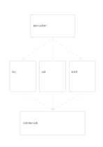

# 仮説と三つの根拠

`hypothesis-evidence` · `causal` · `a5-draft`

[繁體中文](README.zh-TW.md) · [English](README.en.md) · [日本語](README.ja.md) · [一覧へ戻る](../../docs/ja/catalog.md)

検証できる仮説を置き、三つの観察や反例を見てから判断を更新します。

## 向いている場面

- 催しの工夫が参加に本当に影響するか確かめるとき。
- 研究要約の主張と観察できる資料を分けるとき。

## 使い方

1. 反証できる具体的な仮説を上に書きます。
2. 中段の三枠に資料、観察、反例を一つずつ置き、支持か反対か示します。
3. 下には今ある根拠で言える評価と次の確認だけを書きます。

## 記入後に見えること

観察結果と原因の仮説を分け、根拠のない関係を示せます。

## 記入例

架空の読書会で短い通知が出席を増やすという仮説を、申込、出席、未回答で見て、比較対象が必要と記しています。

[SVG](examples/ja.svg)

## 向いていない場面

三枠では複雑な研究を評価しきれず、説明用の数値を実験結果として扱えません。

## ダウンロード

- [文字なしSVG](exports/a5-draft/blank.svg)
- [文字なしPDF](exports/a5-draft/blank.pdf)
- [左上に英語名があるPDF](exports/a5-draft/titled.pdf)
- [濃い線の文字なしPDF](exports/a5-contrast/blank.pdf)
- [濃い線のSVG](exports/a5-contrast/blank.svg)

英語名は表題付きPDFだけに印刷され、文字なし版は自由な記入に使えます。

用紙サイズ：A5（148 × 210 mm）。設定ファイル：`a5-draft`。

## 由来と状態

本プロジェクトの独自レイアウト · 詳しい由来の記録： [manifest.json](manifest.json)  
[MITライセンスの範囲](../../LICENSE-SCOPE.md)

[三言語の用語集](../../docs/ja/glossary.md)

## 変更と再生成

`profiles/a5-draft.json` または `src/noteformats/layouts/` の描画関数を変更し、プロジェクトのルートで実行します：

`python scripts/build.py --ids hypothesis-evidence`
