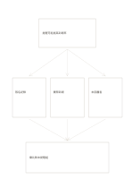

# 假設與三項證據

`hypothesis-evidence` · `causal` · `a5-draft`

[繁體中文](README.zh-TW.md) · [English](README.en.md) · [日本語](README.ja.md) · [返回目錄](../../docs/zh-TW/catalog.md)

先寫一個可檢驗的假設，再列三項支持或反對資料，最後更新判斷。

## 適合情境

- 檢查某項活動設計是否真的改善參與。
- 閱讀研究摘要時分開主張與可觀察資料。

## 使用步驟

1. 上方寫可被資料反駁的明確假設。
2. 中間三卡各記一項來源、觀察或反例，標清楚方向。
3. 下方只寫證據目前允許的暫時評估與下一個查證。

## 整理後可得到

分開觀察結果與原因假設，標出尚無證據的連結。

## 實際填寫示例

示例假設『簡短提醒可提高虛構讀書會到場率』，中間放報名、到場、未回覆資料，底部寫仍需比較基準。

[SVG](examples/zh-TW.svg)

## 不適合情境

三張卡不足以完整評估複雜研究，也不能把示意資料當作實驗結果。

## 下載

- [無字 SVG](exports/a5-draft/blank.svg)
- [無字 PDF](exports/a5-draft/blank.pdf)
- [左上角英文名稱 PDF](exports/a5-draft/titled.pdf)
- [深色墨線無字 PDF](exports/a5-contrast/blank.pdf)
- [深色墨線 SVG](exports/a5-contrast/blank.svg)

英文名稱只印在標題版 PDF；無字版仍適合自由列印與改作。

頁面尺寸：A5（148 × 210 mm）；設定檔：`a5-draft`。

## 來源與狀態

本專案原創版面 · 詳細來源紀錄見 [manifest.json](manifest.json)  
[MIT 授權範圍](../../LICENSE-SCOPE.md)

[三語術語表](../../docs/zh-TW/glossary.md)

## 修改與重新生成

修改 `profiles/a5-draft.json` 或 `src/noteformats/layouts/` 內對應的繪圖函式，再於專案根目錄執行：

`python scripts/build.py --ids hypothesis-evidence`
