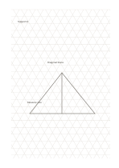

# Isometric triangular grid

`isometric-grid` · `geometry` · `a5-draft`

[繁體中文](README.zh-TW.md) · [English](README.en.md) · [日本語](README.ja.md) · [Back to catalog](../../docs/en/catalog.md)

Use the three-direction lattice to sketch equal-angle objects; verify actual dimensions separately.

## When to use it

**Geometry relationship:** `equivalent` · [triangular-grid](../triangular-grid/README.en.md)

- Sketch block-shaped furniture along the three grid directions to see how its faces meet.
- Compare the forms of block assemblies without treating the sketches as measured drawings.

## How to use it

1. Use the three-direction lattice to sketch equal-angle objects; verify actual dimensions separately.
2. Trace outlines along the three directions without treating the thumbnail as a precise measure.
3. Write down angles and dimensions that still need measurement.

## What the page helps you see

A draft of direction, proportion, or placement, with measurements still to check.

## Worked example

Entries in example-position order; each number identifies one entry:

1. Support A
2. Diagonal brace
3. Measure size

[SVG](examples/en.svg)

## When not to use it

Long prose and rectangular tables are awkward on triangles; an uncalibrated grid does not replace drafting tools. Small cells hold short phrases rather than long paragraphs.

## Downloads

- [Wordless SVG](exports/a5-draft/blank.svg)
- [Wordless PDF](exports/a5-draft/blank.pdf)
- [PDF with English name at top left](exports/a5-draft/titled.pdf)
- [Darker-ink wordless PDF](exports/a5-contrast/blank.pdf)
- [Darker-ink SVG](exports/a5-contrast/blank.svg)

The English name appears only on the titled PDF; the wordless version remains available for free writing.

Page size: A5 (148 × 210 mm); profile: `a5-draft`.

## Provenance and status

Adaptation of traditional writing paper · Detailed source record: [manifest.json](manifest.json)  
[MIT license scope](../../LICENSE-SCOPE.md)

[Trilingual glossary](../../docs/en/glossary.md)

## Modify and rebuild

Edit geometry in `src/noteformats/variants.py` or text in `src/noteformats/variant_content.py`, then run from the project root:

`python scripts/build.py --ids isometric-grid`
