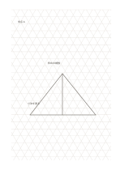

# 等角三角グリッド

`isometric-grid` · `geometry` · `a5-draft`

[繁體中文](README.zh-TW.md) · [English](README.en.md) · [日本語](README.ja.md) · [一覧へ戻る](../../docs/ja/catalog.md)

三方向の等間隔線で等角の物を下書きし、実寸は別に測ります。

## 向いている場面

**図形の対応:** `equivalent` · [triangular-grid](../triangular-grid/README.ja.md)

- 三方向の線に沿って箱形家具を等角で描き、面のつながりを見るとき。
- 積み木の組合せの立体形状を比べ、実測図とは分けて扱うとき。

## 使い方

1. 三方向の等間隔線で等角の物を下書きし、実寸は別に測ります。
2. 三方向の線に沿って輪郭を描き、縮図を精密な測定と混同しません。
3. 実測が必要な角度や寸法を別に記します。

## 記入後に見えること

向き、比率、配置と、追加で測る箇所が見えます。

## 記入例

図の記入位置の順に示します。番号一つが一つの記入例です：

1. 支点 A
2. 斜めの補強
3. 寸法を測る

[SVG](examples/ja.svg)

## 向いていない場面

長文や長方形の表は読みづらく、尺度未確認の方眼は製図道具の代わりにはなりません。 小さなマスは短い語句向けで、長い文章には向きません。

## ダウンロード

- [文字なしSVG](exports/a5-draft/blank.svg)
- [文字なしPDF](exports/a5-draft/blank.pdf)
- [左上に英語名があるPDF](exports/a5-draft/titled.pdf)
- [濃い線の文字なしPDF](exports/a5-contrast/blank.pdf)
- [濃い線のSVG](exports/a5-contrast/blank.svg)

英語名は表題付きPDFだけに印刷され、文字なし版は自由な記入に使えます。

用紙サイズ：A5（148 × 210 mm）。設定ファイル：`a5-draft`。

## 由来と状態

伝統的な練習紙の応用 · 詳しい由来の記録： [manifest.json](manifest.json)  
[MITライセンスの範囲](../../LICENSE-SCOPE.md)

[三言語の用語集](../../docs/ja/glossary.md)

## 変更と再生成

図形は `src/noteformats/variants.py`、文章は `src/noteformats/variant_content.py` を変更し、プロジェクトのルートで実行します：

`python scripts/build.py --ids isometric-grid`
