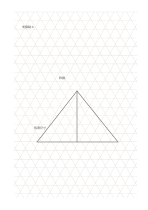

# 等角三角格

`isometric-grid` · `geometry` · `a5-draft`

[繁體中文](README.zh-TW.md) · [English](README.en.md) · [日本語](README.ja.md) · [返回目錄](../../docs/zh-TW/catalog.md)

利用三方向等距格線構思等角物件，尺寸仍須另行量測。

## 適合情境

**幾何對照:** `equivalent` · [triangular-grid](../triangular-grid/README.zh-TW.md)

- 沿三方向格線畫方塊家具的等角草圖，觀察各面的相接方式。
- 比較積木組合的立體外形，不把草圖當成實測尺寸圖。

## 使用步驟

1. 利用三方向等距格線構思等角物件，尺寸仍須另行量測。
2. 沿三個線向畫輪廓，避免把縮圖當精密量測。
3. 在格外記下需實測的角度與尺寸。

## 整理後可得到

看出方向、比例或空間配置中需要再測量之處。

## 實際填寫示例

依圖中填寫位置順序列出，每個編號是一筆示例條目：

1. 支撐點 A
2. 斜撐
3. 待測尺寸

[SVG](examples/zh-TW.svg)

## 不適合情境

長篇筆記或矩形表格不易沿三角格閱讀；尚未標定的網格不能替代製圖工具。 細小格子只宜短語，不適合長篇段落。

## 下載

- [無字 SVG](exports/a5-draft/blank.svg)
- [無字 PDF](exports/a5-draft/blank.pdf)
- [左上角英文名稱 PDF](exports/a5-draft/titled.pdf)
- [深色墨線無字 PDF](exports/a5-contrast/blank.pdf)
- [深色墨線 SVG](exports/a5-contrast/blank.svg)

英文名稱只印在標題版 PDF；無字版仍適合自由列印與改作。

頁面尺寸：A5（148 × 210 mm）；設定檔：`a5-draft`。

## 來源與狀態

傳統書寫紙改編 · 詳細來源紀錄見 [manifest.json](manifest.json)  
[MIT 授權範圍](../../LICENSE-SCOPE.md)

[三語術語表](../../docs/zh-TW/glossary.md)

## 修改與重新生成

調整 `src/noteformats/variants.py` 的幾何或 `src/noteformats/variant_content.py` 的文字，再於專案根目錄執行：

`python scripts/build.py --ids isometric-grid`
