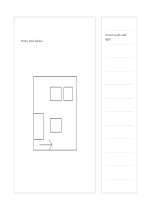

# Main sketch with side notes

`main-sketch-side-notes` · `storyboard` · `a5-draft`

[繁體中文](README.zh-TW.md) · [English](README.en.md) · [日本語](README.ja.md) · [Back to catalog](../../docs/en/catalog.md)

Reserve a large drawing field and keep observations and revisions in a narrow side column.

## When to use it

- Sketch an exhibition floor idea and note route concerns.
- Draw a product form and list materials or dimensions to verify.

## How to use it

1. Draw the main idea on the left without pretending it is to scale.
2. Use the right lines for observations, questions, and dimensions to check.
3. Mark matching places on the sketch so each note has a location.

## What the page helps you see

A visual sequence showing transitions and missing shots.

## Worked example

A fictional exhibition sketch places an entry and tables on the left; the right asks about accessible width and possible glare.

[SVG](examples/en.svg)

## When not to use it

This is not an engineering plan or measured drawing, and the narrow column cannot hold a full specification.

## Downloads

- [Wordless SVG](exports/a5-draft/blank.svg)
- [Wordless PDF](exports/a5-draft/blank.pdf)
- [PDF with English name at top left](exports/a5-draft/titled.pdf)
- [Darker-ink wordless PDF](exports/a5-contrast/blank.pdf)
- [Darker-ink SVG](exports/a5-contrast/blank.svg)

The English name appears only on the titled PDF; the wordless version remains available for free writing.

Page size: A5 (148 × 210 mm); profile: `a5-draft`.

## Provenance and status

Original layout · Detailed source record: [manifest.json](manifest.json)  
[MIT license scope](../../LICENSE-SCOPE.md)

[Trilingual glossary](../../docs/en/glossary.md)

## Modify and rebuild

Change `profiles/a5-draft.json` or the corresponding builder in `src/noteformats/layouts/`, then run from the project root:

`python scripts/build.py --ids main-sketch-side-notes`
