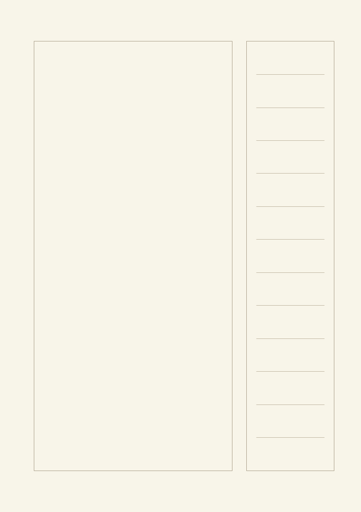
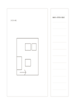

# 主スケッチと側面メモ

`main-sketch-side-notes` · `storyboard` · `a5-draft`

[繁體中文](README.zh-TW.md) · [English](README.en.md) · [日本語](README.ja.md) · [一覧へ戻る](../../docs/ja/catalog.md)

大きな図を左に置き、観察や修正案を細い右欄に集めます。

## 向いている場面

- 展示の平面案を描き、動線の問題を記すとき。
- 製品の外形を描き、材料や寸法の確認点を書くとき。

## 使い方

1. 左に主要な案を描き、正確な縮尺だとはみなしません。
2. 右の行に観察、疑問、確認する寸法を書きます。
3. 図の対応位置に印をつけ、メモと結びます。

## 記入後に見えること

連続した場面から変化や足りないカットが見えます。

## 記入例

架空の展示で左に入口と机を描き、右に通路幅の確認や照明の反射への疑問を書きます。

[SVG](examples/ja.svg)

## 向いていない場面

工学図面や実測図ではありません。細い右欄に完全な仕様書も入りません。

## ダウンロード

- [文字なしSVG](exports/a5-draft/blank.svg)
- [文字なしPDF](exports/a5-draft/blank.pdf)
- [左上に英語名があるPDF](exports/a5-draft/titled.pdf)
- [濃い線の文字なしPDF](exports/a5-contrast/blank.pdf)
- [濃い線のSVG](exports/a5-contrast/blank.svg)

英語名は表題付きPDFだけに印刷され、文字なし版は自由な記入に使えます。

用紙サイズ：A5（148 × 210 mm）。設定ファイル：`a5-draft`。

## 由来と状態

本プロジェクトの独自レイアウト · 詳しい由来の記録： [manifest.json](manifest.json)  
[MITライセンスの範囲](../../LICENSE-SCOPE.md)

[三言語の用語集](../../docs/ja/glossary.md)

## 変更と再生成

`profiles/a5-draft.json` または `src/noteformats/layouts/` の描画関数を変更し、プロジェクトのルートで実行します：

`python scripts/build.py --ids main-sketch-side-notes`
