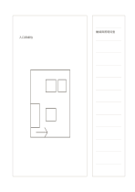

# 主草圖與側邊筆記

`main-sketch-side-notes` · `storyboard` · `a5-draft`

[繁體中文](README.zh-TW.md) · [English](README.en.md) · [日本語](README.ja.md) · [返回目錄](../../docs/zh-TW/catalog.md)

讓一張主要草圖保留寬幅畫面，右側集中記觀察與修改。

## 適合情境

- 畫展場平面概念並記動線問題。
- 畫產品外形並記材料與尺寸待查項。

## 使用步驟

1. 左側先畫一個主要草圖，暫不追求精確比例。
2. 右側逐行寫觀察、問題與要查的尺寸。
3. 在圖上圈對應位置，將右側筆記對回草圖。

## 整理後可得到

從連續畫面看出事件轉折與仍缺的鏡頭。

## 實際填寫示例

虛構展場左側畫入口與桌位，右側記『輪椅通道寬度待查』『照明可能反光』。

[SVG](examples/zh-TW.svg)

## 不適合情境

不是工程圖或實際尺寸圖；右欄也不容完整的規格書。

## 下載

- [無字 SVG](exports/a5-draft/blank.svg)
- [無字 PDF](exports/a5-draft/blank.pdf)
- [左上角英文名稱 PDF](exports/a5-draft/titled.pdf)
- [深色墨線無字 PDF](exports/a5-contrast/blank.pdf)
- [深色墨線 SVG](exports/a5-contrast/blank.svg)

英文名稱只印在標題版 PDF；無字版仍適合自由列印與改作。

頁面尺寸：A5（148 × 210 mm）；設定檔：`a5-draft`。

## 來源與狀態

本專案原創版面 · 詳細來源紀錄見 [manifest.json](manifest.json)  
[MIT 授權範圍](../../LICENSE-SCOPE.md)

[三語術語表](../../docs/zh-TW/glossary.md)

## 修改與重新生成

修改 `profiles/a5-draft.json` 或 `src/noteformats/layouts/` 內對應的繪圖函式，再於專案根目錄執行：

`python scripts/build.py --ids main-sketch-side-notes`
