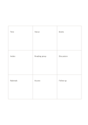

# 3×3 idea expansion

`mandala-3x3` · `mandala` · `a5-draft`

[繁體中文](README.zh-TW.md) · [English](README.en.md) · [日本語](README.ja.md) · [Back to catalog](../../docs/en/catalog.md)

Put one question in the center and explore eight distinct aspects around it.

## When to use it

- List possible angles before drafting an article.
- Explore participants, venue, materials, and other aspects of a community event.

## How to use it

1. Write one clear topic or question in the middle cell.
2. Fill the eight surrounding cells with different aspects before judging them.
3. Look for repetition or vague entries and revise them.
4. Choose two or three cells for deeper work on another page, noting information still missing.

## What the page helps you see

Several directions to explore from a central topic.

## Worked example

A fictional neighborhood reading group is placed in the center, surrounded by time, venue, books, invitations, discussion, materials, access, and follow-up.

[SVG](examples/en.svg)

## When not to use it

Equal small cells are limiting when each aspect needs a long paragraph or when a strict sequence matters.

## Downloads

- [Wordless SVG](exports/a5-draft/blank.svg)
- [Wordless PDF](exports/a5-draft/blank.pdf)
- [PDF with English name at top left](exports/a5-draft/titled.pdf)
- [Darker-ink wordless PDF](exports/a5-contrast/blank.pdf)
- [Darker-ink SVG](exports/a5-contrast/blank.svg)

The English name appears only on the titled PDF; the wordless version remains available for free writing.

Page size: A5 (148 × 210 mm); profile: `a5-draft`.

## Provenance and status

Adaptation of an existing method · Detailed source record: [manifest.json](manifest.json)  
[MIT license scope](../../LICENSE-SCOPE.md)

[Trilingual glossary](../../docs/en/glossary.md)

## Modify and rebuild

Change `profiles/a5-draft.json` or the corresponding builder in `src/noteformats/layouts/`, then run from the project root:

`python scripts/build.py --ids mandala-3x3`
