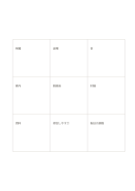

# 3×3のアイデア展開

`mandala-3x3` · `mandala` · `a5-draft`

[繁體中文](README.zh-TW.md) · [English](README.en.md) · [日本語](README.ja.md) · [一覧へ戻る](../../docs/ja/catalog.md)

中心に一つの問いを置き、周囲の八方向へ異なる観点を広げます。

## 向いている場面

- 文章を書く前に、扱える切り口を洗い出すとき。
- 地域の催しについて、参加者、会場、資料などを考えるとき。

## 使い方

1. 中央のマスに明確な主題か問いを書きます。
2. 周囲の八マスに、評価する前に異なる観点を一つずつ書きます。
3. 重複や曖昧な言葉がないか見直して直します。
4. 二、三のマスを別のページで深め、足りない情報も記録します。

## 記入後に見えること

中心のテーマから次に調べる方向を広げられます。

## 記入例

架空の地域読書会を中心に置き、時間、会場、本、案内、討論、資料、参加しやすさ、後日の連絡を周囲に書いています。

[SVG](examples/ja.svg)

## 向いていない場面

各観点に長い文章が必要な場合や順序が重要な場合、同じ大きさの小さなマスでは窮屈です。

## ダウンロード

- [文字なしSVG](exports/a5-draft/blank.svg)
- [文字なしPDF](exports/a5-draft/blank.pdf)
- [左上に英語名があるPDF](exports/a5-draft/titled.pdf)
- [濃い線の文字なしPDF](exports/a5-contrast/blank.pdf)
- [濃い線のSVG](exports/a5-contrast/blank.svg)

英語名は表題付きPDFだけに印刷され、文字なし版は自由な記入に使えます。

用紙サイズ：A5（148 × 210 mm）。設定ファイル：`a5-draft`。

## 由来と状態

既存の方法を配置に応用 · 詳しい由来の記録： [manifest.json](manifest.json)  
[MITライセンスの範囲](../../LICENSE-SCOPE.md)

[三言語の用語集](../../docs/ja/glossary.md)

## 変更と再生成

`profiles/a5-draft.json` または `src/noteformats/layouts/` の描画関数を変更し、プロジェクトのルートで実行します：

`python scripts/build.py --ids mandala-3x3`
