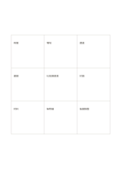

# 九宮概念展開

`mandala-3x3` · `mandala` · `a5-draft`

[繁體中文](README.zh-TW.md) · [English](README.en.md) · [日本語](README.ja.md) · [返回目錄](../../docs/zh-TW/catalog.md)

把核心問題放在中間，向八個方向展開不同切面。

## 適合情境

- 在文章動筆前列出可寫的不同角度。
- 替社區活動發想參與者、場地、材料等面向。

## 使用步驟

1. 在中央格寫一個明確的主題或問題。
2. 在周圍八格各填一個不同面向，先求多樣，不急著評分。
3. 檢查是否有重複或過於籠統的面向，必要時改寫。
4. 挑出兩三格另開新頁深入研究，並記下仍缺的資料。

## 整理後可得到

從中心主題展開多個可再追問的面向。

## 實際填寫示例

以虛構的社區讀書會為中心，周圍填入時間、場地、選書、邀請、討論、材料、無障礙與後續聯繫。

[SVG](examples/zh-TW.svg)

## 不適合情境

當每個面向需要長段文字或嚴格的先後流程時，九個等大的格子會過於侷促。

## 下載

- [無字 SVG](exports/a5-draft/blank.svg)
- [無字 PDF](exports/a5-draft/blank.pdf)
- [左上角英文名稱 PDF](exports/a5-draft/titled.pdf)
- [深色墨線無字 PDF](exports/a5-contrast/blank.pdf)
- [深色墨線 SVG](exports/a5-contrast/blank.svg)

英文名稱只印在標題版 PDF；無字版仍適合自由列印與改作。

頁面尺寸：A5（148 × 210 mm）；設定檔：`a5-draft`。

## 來源與狀態

既有方法的版面改編 · 詳細來源紀錄見 [manifest.json](manifest.json)  
[MIT 授權範圍](../../LICENSE-SCOPE.md)

[三語術語表](../../docs/zh-TW/glossary.md)

## 修改與重新生成

修改 `profiles/a5-draft.json` 或 `src/noteformats/layouts/` 內對應的繪圖函式，再於專案根目錄執行：

`python scripts/build.py --ids mandala-3x3`
