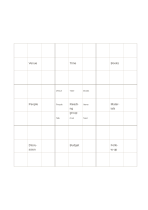

# 81-cell idea expansion

`mandala-9x9` · `mandala` · `a5-draft`

[繁體中文](README.zh-TW.md) · [English](README.en.md) · [日本語](README.ja.md) · [Back to catalog](../../docs/en/catalog.md)

Use nine grouped three-by-three blocks to extend a central topic into short keywords.

## When to use it

- You already have eight subtopics and want several brief extensions for each.
- You need a broad topic inventory before outlining an article, not full paragraphs.

## How to use it

1. Put a very short topic in the center cell.
2. Place eight subtopics around the center and repeat each in the center of its outer block.
3. Add only short words to outer blocks; move ideas needing sentences to another page.

## What the page helps you see

Several directions to explore from a central topic.

## Worked example

A fictional reading group begins with venue, time, books, participation, materials, discussion, budget, and follow-up; only representative cells are filled.

[SVG](examples/en.svg)

## When not to use it

At A5 each cell is about 13.7 mm wide, suitable for keywords only. Use larger paper for sentences or precise production work.

## Downloads

- [Wordless SVG](exports/a5-draft/blank.svg)
- [Wordless PDF](exports/a5-draft/blank.pdf)
- [PDF with English name at top left](exports/a5-draft/titled.pdf)
- [Darker-ink wordless PDF](exports/a5-contrast/blank.pdf)
- [Darker-ink SVG](exports/a5-contrast/blank.svg)

The English name appears only on the titled PDF; the wordless version remains available for free writing.

Page size: A5 (148 × 210 mm); profile: `a5-draft`.

## Provenance and status

Adaptation of an existing method · Detailed source record: [manifest.json](manifest.json)  
[MIT license scope](../../LICENSE-SCOPE.md)

[Trilingual glossary](../../docs/en/glossary.md)

## Modify and rebuild

Change `profiles/a5-draft.json` or the corresponding builder in `src/noteformats/layouts/`, then run from the project root:

`python scripts/build.py --ids mandala-9x9`
