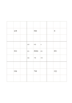

# 81マスのアイデア展開

`mandala-9x9` · `mandala` · `a5-draft`

[繁體中文](README.zh-TW.md) · [English](README.en.md) · [日本語](README.ja.md) · [一覧へ戻る](../../docs/ja/catalog.md)

九つの3×3区画を使い、中心の主題から短い語を段階的に広げます。

## 向いている場面

- 八つの小主題があり、それぞれに短い関連語を足すとき。
- 文章の構成前に広い観点を洗い出し、段落は別に書くとき。

## 使い方

1. 中央の小さなマスに短い主題を書きます。
2. 八つの小主題を中央の周囲に置き、対応する外側区画の中心にも写します。
3. 外側は短い語だけにし、文が必要な考えは別のページへ移します。

## 記入後に見えること

中心のテーマから次に調べる方向を広げられます。

## 記入例

架空の読書会から会場、時間、本、参加、資料、討論、予算、次回へ広げ、代表的なマスだけを埋めています。

[SVG](examples/ja.svg)

## 向いていない場面

A5では一マス約13.7 mmで、短い語向けです。長文や精密な印刷には大きな用紙が必要です。

## ダウンロード

- [文字なしSVG](exports/a5-draft/blank.svg)
- [文字なしPDF](exports/a5-draft/blank.pdf)
- [左上に英語名があるPDF](exports/a5-draft/titled.pdf)
- [濃い線の文字なしPDF](exports/a5-contrast/blank.pdf)
- [濃い線のSVG](exports/a5-contrast/blank.svg)

英語名は表題付きPDFだけに印刷され、文字なし版は自由な記入に使えます。

用紙サイズ：A5（148 × 210 mm）。設定ファイル：`a5-draft`。

## 由来と状態

既存の方法を配置に応用 · 詳しい由来の記録： [manifest.json](manifest.json)  
[MITライセンスの範囲](../../LICENSE-SCOPE.md)

[三言語の用語集](../../docs/ja/glossary.md)

## 変更と再生成

`profiles/a5-draft.json` または `src/noteformats/layouts/` の描画関数を変更し、プロジェクトのルートで実行します：

`python scripts/build.py --ids mandala-9x9`
