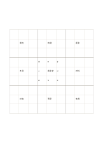

# 八十一格概念展開

`mandala-9x9` · `mandala` · `a5-draft`

[繁體中文](README.zh-TW.md) · [English](README.en.md) · [日本語](README.ja.md) · [返回目錄](../../docs/zh-TW/catalog.md)

用九組三乘三小格，從中心主題逐層分出短關鍵詞。

## 適合情境

- 已有八個子題，想各列幾個很短的延伸詞。
- 在文章規劃前盤點廣泛面向，而非寫完整段落。

## 使用步驟

1. 先在中央小格寫一個極短主題。
2. 將八個子題放到中央區塊周圍，再移到對應外側區塊的中心。
3. 各外側區塊只補短詞，遇到需要句子的內容就另開頁。

## 整理後可得到

從中心主題展開多個可再追問的面向。

## 實際填寫示例

示例以虛構社區讀書會為核心，八組先列場地、時間、選書、參與、材料、討論、預算、後續；只填代表性小格。

[SVG](examples/zh-TW.svg)

## 不適合情境

A5 上每格約 13.7 mm，只適合短詞或單字；手寫長句與精密印刷須另用更大紙張。

## 下載

- [無字 SVG](exports/a5-draft/blank.svg)
- [無字 PDF](exports/a5-draft/blank.pdf)
- [左上角英文名稱 PDF](exports/a5-draft/titled.pdf)
- [深色墨線無字 PDF](exports/a5-contrast/blank.pdf)
- [深色墨線 SVG](exports/a5-contrast/blank.svg)

英文名稱只印在標題版 PDF；無字版仍適合自由列印與改作。

頁面尺寸：A5（148 × 210 mm）；設定檔：`a5-draft`。

## 來源與狀態

既有方法的版面改編 · 詳細來源紀錄見 [manifest.json](manifest.json)  
[MIT 授權範圍](../../LICENSE-SCOPE.md)

[三語術語表](../../docs/zh-TW/glossary.md)

## 修改與重新生成

修改 `profiles/a5-draft.json` 或 `src/noteformats/layouts/` 內對應的繪圖函式，再於專案根目錄執行：

`python scripts/build.py --ids mandala-9x9`
