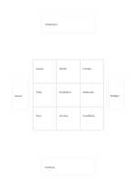

# Nine cells with four extensions

`mandala-extended` · `mandala` · `a5-draft`

[繁體中文](README.zh-TW.md) · [English](README.en.md) · [日本語](README.ja.md) · [Back to catalog](../../docs/en/catalog.md)

Expand in a central nine-cell square, then reserve four outside cards for the next pass.

## When to use it

- The nine cells are full but four questions need further work.
- Select four aspects to test after a brainstorming meeting.

## How to use it

1. Put the topic in the center and first-pass ideas around it.
2. Use the outer top, bottom, left, and right cards only for next-pass short topics.
3. Open a separate page or task for each extension instead of squeezing in full notes.

## What the page helps you see

Several directions to explore from a central topic.

## Worked example

A fictional neighborhood exhibition uses nine cells for resources and people, and outer cards for venue, budget, volunteers, and publicity to check.

[SVG](examples/en.svg)

## When not to use it

Outer cards are narrow and cannot hold sentences; an ordinary nine-cell sheet is clearer without a second pass.

## Downloads

- [Wordless SVG](exports/a5-draft/blank.svg)
- [Wordless PDF](exports/a5-draft/blank.pdf)
- [PDF with English name at top left](exports/a5-draft/titled.pdf)
- [Darker-ink wordless PDF](exports/a5-contrast/blank.pdf)
- [Darker-ink SVG](exports/a5-contrast/blank.svg)

The English name appears only on the titled PDF; the wordless version remains available for free writing.

Page size: A5 (148 × 210 mm); profile: `a5-draft`.

## Provenance and status

Original layout · Detailed source record: [manifest.json](manifest.json)  
[MIT license scope](../../LICENSE-SCOPE.md)

[Trilingual glossary](../../docs/en/glossary.md)

## Modify and rebuild

Change `profiles/a5-draft.json` or the corresponding builder in `src/noteformats/layouts/`, then run from the project root:

`python scripts/build.py --ids mandala-extended`
