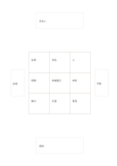

# 九マスと四方向の拡張

`mandala-extended` · `mandala` · `a5-draft`

[繁體中文](README.zh-TW.md) · [English](README.en.md) · [日本語](README.ja.md) · [一覧へ戻る](../../docs/ja/catalog.md)

中央の九マスで広げたあと、外側の四枠に次の検討方向を残します。

## 向いている場面

- 九マスが埋まっても、さらに調べたい四つの問いがあるとき。
- 発想会議のあと、試すべき四面を選ぶとき。

## 使い方

1. 中央に主題、周囲に最初の考えを書きます。
2. 上下左右の外枠には次に深める短い題だけを書きます。
3. 外枠ごとに別のページや作業を作り、小枠を全文メモにしません。

## 記入後に見えること

中心のテーマから次に調べる方向を広げられます。

## 記入例

架空の地域展示会を九マスで考え、会場、予算、手伝い、周知などを外に残して調べます。

[SVG](examples/ja.svg)

## 向いていない場面

外枠は狭く文を載せられません。次段階が不要なら普通の九マスの方が明確です。

## ダウンロード

- [文字なしSVG](exports/a5-draft/blank.svg)
- [文字なしPDF](exports/a5-draft/blank.pdf)
- [左上に英語名があるPDF](exports/a5-draft/titled.pdf)
- [濃い線の文字なしPDF](exports/a5-contrast/blank.pdf)
- [濃い線のSVG](exports/a5-contrast/blank.svg)

英語名は表題付きPDFだけに印刷され、文字なし版は自由な記入に使えます。

用紙サイズ：A5（148 × 210 mm）。設定ファイル：`a5-draft`。

## 由来と状態

本プロジェクトの独自レイアウト · 詳しい由来の記録： [manifest.json](manifest.json)  
[MITライセンスの範囲](../../LICENSE-SCOPE.md)

[三言語の用語集](../../docs/ja/glossary.md)

## 変更と再生成

`profiles/a5-draft.json` または `src/noteformats/layouts/` の描画関数を変更し、プロジェクトのルートで実行します：

`python scripts/build.py --ids mandala-extended`
