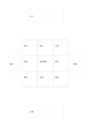

# 九宮加四向延伸

`mandala-extended` · `mandala` · `a5-draft`

[繁體中文](README.zh-TW.md) · [English](README.en.md) · [日本語](README.ja.md) · [返回目錄](../../docs/zh-TW/catalog.md)

先在中央九宮展開，再用四個外部小框保留下一輪方向。

## 適合情境

- 九宮格已填滿，仍有四個值得另頁追問的題目。
- 會議發想後選出四個需實際驗證的面向。

## 使用步驟

1. 中央格寫主題，周圍八格記第一輪想法。
2. 在上、下、左、右外框只寫下一輪要深入的短題。
3. 為外框各開新頁或任務，不把小框當完整筆記。

## 整理後可得到

從中心主題展開多個可再追問的面向。

## 實際填寫示例

示例從虛構社區展覽出發，九宮列資源與人員，四外框留場地、預算、志工、宣傳供後續追查。

[SVG](examples/zh-TW.svg)

## 不適合情境

外框很窄，不適合長句；未需要第二輪展開時普通九宮較清楚。

## 下載

- [無字 SVG](exports/a5-draft/blank.svg)
- [無字 PDF](exports/a5-draft/blank.pdf)
- [左上角英文名稱 PDF](exports/a5-draft/titled.pdf)
- [深色墨線無字 PDF](exports/a5-contrast/blank.pdf)
- [深色墨線 SVG](exports/a5-contrast/blank.svg)

英文名稱只印在標題版 PDF；無字版仍適合自由列印與改作。

頁面尺寸：A5（148 × 210 mm）；設定檔：`a5-draft`。

## 來源與狀態

本專案原創版面 · 詳細來源紀錄見 [manifest.json](manifest.json)  
[MIT 授權範圍](../../LICENSE-SCOPE.md)

[三語術語表](../../docs/zh-TW/glossary.md)

## 修改與重新生成

修改 `profiles/a5-draft.json` 或 `src/noteformats/layouts/` 內對應的繪圖函式，再於專案根目錄執行：

`python scripts/build.py --ids mandala-extended`
