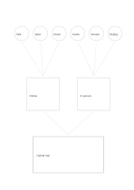

# Many-to-one idea funnel

`many-to-one-funnel` · `ideation` · `a5-draft`

[繁體中文](README.zh-TW.md) · [English](README.en.md) · [日本語](README.ja.md) · [Back to catalog](../../docs/en/catalog.md)

Collect six ideas, group them twice, and state one small synthesis to try.

## When to use it

- Narrow community-event ideas into a pilot proposal.
- Find two recurring themes across reading notes.

## How to use it

1. Write distinct ideas in the six upper nodes without ranking them yet.
2. Group related ideas in the two middle areas while preserving differences.
3. State one testable synthesis below and note what remains unknown.

## What the page helps you see

Multiple proposals with a basis for the next selection step.

## Worked example

Six fictional reading-group ideas form online and in-person clusters, then a small hybrid trial is proposed below.

[SVG](examples/en.svg)

## When not to use it

The funnel does not prove the final proposal is best; an outlying idea may deserve its own trial.

## Downloads

- [Wordless SVG](exports/a5-draft/blank.svg)
- [Wordless PDF](exports/a5-draft/blank.pdf)
- [PDF with English name at top left](exports/a5-draft/titled.pdf)
- [Darker-ink wordless PDF](exports/a5-contrast/blank.pdf)
- [Darker-ink SVG](exports/a5-contrast/blank.svg)

The English name appears only on the titled PDF; the wordless version remains available for free writing.

Page size: A5 (148 × 210 mm); profile: `a5-draft`.

## Provenance and status

Original layout · Detailed source record: [manifest.json](manifest.json)  
[MIT license scope](../../LICENSE-SCOPE.md)

[Trilingual glossary](../../docs/en/glossary.md)

## Modify and rebuild

Change `profiles/a5-draft.json` or the corresponding builder in `src/noteformats/layouts/`, then run from the project root:

`python scripts/build.py --ids many-to-one-funnel`
