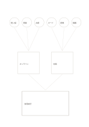

# 複数案をまとめる漏斗

`many-to-one-funnel` · `ideation` · `a5-draft`

[繁體中文](README.zh-TW.md) · [English](README.en.md) · [日本語](README.ja.md) · [一覧へ戻る](../../docs/ja/catalog.md)

六つの案を二群にまとめ、最後に小さく試せる統合案を書きます。

## 向いている場面

- 地域催事の案を試行案へ絞るとき。
- 読書メモから二つの共通傾向を見つけるとき。

## 使い方

1. 上の六円に異なる案を、先に評価せず書きます。
2. 中段の二枠に近い案をまとめ、違いも残します。
3. 下に試せる統合案と未確認事項を書きます。

## 記入後に見えること

複数の案と、次に選ぶための基準が残ります。

## 記入例

架空の読書会案をオンライン交流と対面交流にまとめ、最後に小さな併用案を置きます。

[SVG](examples/ja.svg)

## 向いていない場面

漏斗の形は最終案が最良だという証明ではありません。独立して試す価値のある案も残します。

## ダウンロード

- [文字なしSVG](exports/a5-draft/blank.svg)
- [文字なしPDF](exports/a5-draft/blank.pdf)
- [左上に英語名があるPDF](exports/a5-draft/titled.pdf)
- [濃い線の文字なしPDF](exports/a5-contrast/blank.pdf)
- [濃い線のSVG](exports/a5-contrast/blank.svg)

英語名は表題付きPDFだけに印刷され、文字なし版は自由な記入に使えます。

用紙サイズ：A5（148 × 210 mm）。設定ファイル：`a5-draft`。

## 由来と状態

本プロジェクトの独自レイアウト · 詳しい由来の記録： [manifest.json](manifest.json)  
[MITライセンスの範囲](../../LICENSE-SCOPE.md)

[三言語の用語集](../../docs/ja/glossary.md)

## 変更と再生成

`profiles/a5-draft.json` または `src/noteformats/layouts/` の描画関数を変更し、プロジェクトのルートで実行します：

`python scripts/build.py --ids many-to-one-funnel`
