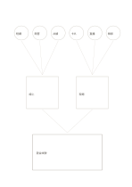

# 多想法收斂漏斗

`many-to-one-funnel` · `ideation` · `a5-draft`

[繁體中文](README.zh-TW.md) · [English](README.en.md) · [日本語](README.ja.md) · [返回目錄](../../docs/zh-TW/catalog.md)

先列六個想法，再分兩群，最後寫出一個可試的整合方向。

## 適合情境

- 討論社區活動時從多個點子收斂成一個試辦方案。
- 從閱讀便條中找出兩類共同線索。

## 使用步驟

1. 頂部六圈快速寫不同想法，不先評分。
2. 中間兩框將相近想法歸群，保留原來的差異。
3. 底部寫一個可小規模測試的綜合提案，記下仍待確認的事。

## 整理後可得到

保留多種方案並說明下一輪篩選依據。

## 實際填寫示例

虛構讀書會的六個活動點子先分成線上互動與現場交流兩群，底部提出一次混合試辦。

[SVG](examples/zh-TW.svg)

## 不適合情境

漏斗形狀不表示最終提案必然最好；少數點子可能值得獨立保留。

## 下載

- [無字 SVG](exports/a5-draft/blank.svg)
- [無字 PDF](exports/a5-draft/blank.pdf)
- [左上角英文名稱 PDF](exports/a5-draft/titled.pdf)
- [深色墨線無字 PDF](exports/a5-contrast/blank.pdf)
- [深色墨線 SVG](exports/a5-contrast/blank.svg)

英文名稱只印在標題版 PDF；無字版仍適合自由列印與改作。

頁面尺寸：A5（148 × 210 mm）；設定檔：`a5-draft`。

## 來源與狀態

本專案原創版面 · 詳細來源紀錄見 [manifest.json](manifest.json)  
[MIT 授權範圍](../../LICENSE-SCOPE.md)

[三語術語表](../../docs/zh-TW/glossary.md)

## 修改與重新生成

修改 `profiles/a5-draft.json` 或 `src/noteformats/layouts/` 內對應的繪圖函式，再於專案根目錄執行：

`python scripts/build.py --ids many-to-one-funnel`
