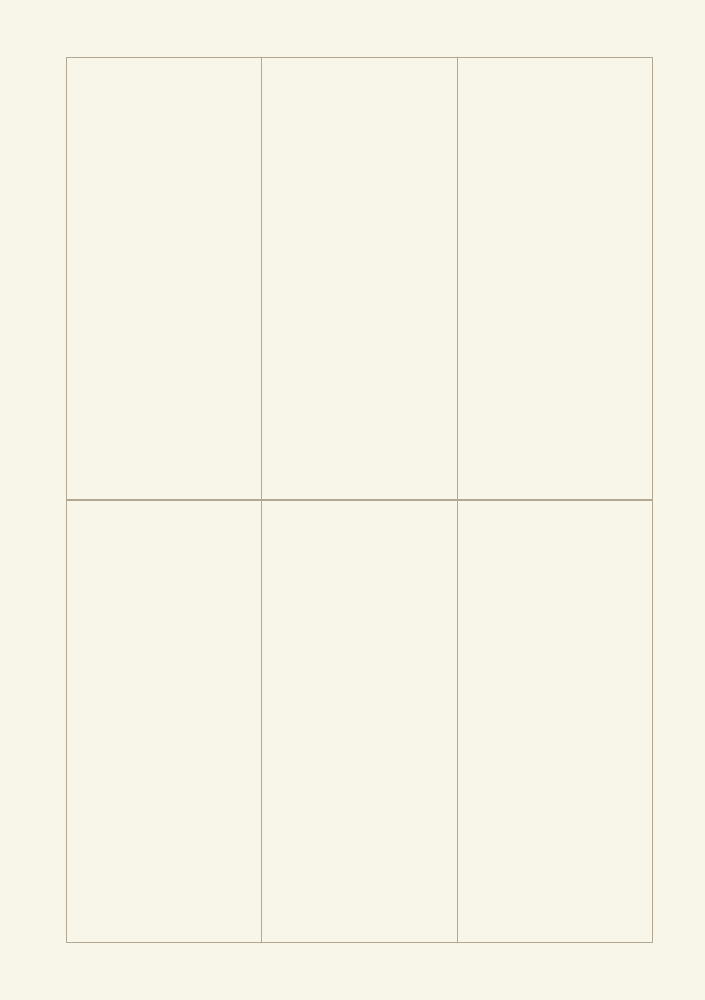
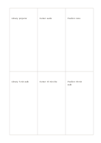

# Two-by-three matrix

`matrix-2x3` · `matrix` · `a5-draft`

[繁體中文](README.zh-TW.md) · [English](README.en.md) · [日本語](README.ja.md) · [Back to catalog](../../docs/en/catalog.md)

Use six adjoining cells for the intersection of two criteria and three options.

## When to use it

- Compare equipment and access for three venues.
- Record how three sources answer two questions.

## How to use it

1. Define what the two rows and three columns mean on your own sheet.
2. Put brief evidence for each row-column intersection in its cell.
3. Read across and down to find missing information.

## What the page helps you see

Intersections, missing cells, and tradeoffs across chosen dimensions.

## Worked example

A fictional reading group compares library, community center, and pavilion across equipment and travel access.

[SVG](examples/en.svg)

## When not to use it

Cells are too narrow for paragraphs; numerical scores need stated units.

## Downloads

- [Wordless SVG](exports/a5-draft/blank.svg)
- [Wordless PDF](exports/a5-draft/blank.pdf)
- [PDF with English name at top left](exports/a5-draft/titled.pdf)
- [Darker-ink wordless PDF](exports/a5-contrast/blank.pdf)
- [Darker-ink SVG](exports/a5-contrast/blank.svg)

The English name appears only on the titled PDF; the wordless version remains available for free writing.

Page size: A5 (148 × 210 mm); profile: `a5-draft`.

## Provenance and status

Generic geometry · Detailed source record: [manifest.json](manifest.json)  
[MIT license scope](../../LICENSE-SCOPE.md)

[Trilingual glossary](../../docs/en/glossary.md)

## Modify and rebuild

Change `profiles/a5-draft.json` or the corresponding builder in `src/noteformats/layouts/`, then run from the project root:

`python scripts/build.py --ids matrix-2x3`
